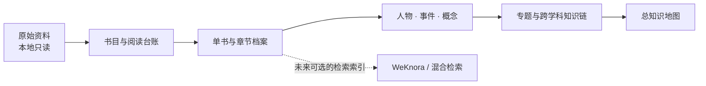

# 人文知识库总控目录

> 以原典为锚，以页码为路标，以关系为地图。

这里保存的是一份持续生长的私人阅读档案：从当代艺术与现代艺术出发，连接现代史、社会学与哲学。它的目标不是替书下结论，而是让每条判断都能回到原文，让不同学科在具体作品、人物和历史条件之间相遇。

## 一、从这里开始

| 需要做什么 | 先看哪里 |
|---|---|
| 接续最近的阅读 | [当前工作状态](当前工作状态.md) |
| 查阅全部藏书与阅读优先级 | [总书目](总书目.md) |
| 判断阅读状态与整理口径 | [阅读进度](阅读进度.md)、[分类规则](分类规则.md) |
| 新建章节或概念笔记 | [章节与词条档案模板](章节与词条档案模板.md) |
| 查找原书推荐资料 | [Further Reading 主题导航](../01_单书档案/Art%20Since%201900%20Further%20Reading目录.md) |
| 查找原书列出的在线资源 | [在线资源目录](../01_单书档案/Art%20Since%201900在线资源目录.md) |
| 了解原件保护、证据等级和笔记格式 | [知识库建设规则](知识库建设规则.md) |
| 按年度查看《Art Since 1900》阅读位置 | [页码阅读追踪](Art%20Since%201900页码阅读追踪.md) |
| 了解 WeKnora 与检索接入建议 | [WeKnora 接入评估](WeKnora接入评估.md) |

## 二、档案地图

```text
00_项目管理       目录、书目、阅读状态、页码与维护规则
01_单书档案       读过的书与章节笔记；保留原文定位
02_人物知识库     思想家、社会学家、艺术家与历史人物
03_历史事件       事件、社会背景、影响与证据
04_核心概念       概念定义、思想家差异与艺术关联
05_专题档案       由一个清晰问题组织的研究记录
06_跨学科知识链   历史—社会—理论—艺术之间的可追溯关系
12_知识地图       全库脉络与重点入口
13_结构化数据     稳定实体ID和少量有来源的关系
```



## 三、四条阅读经纬

- **艺术**：现代艺术、当代艺术、艺术家、运动、展览、媒介与制度。
- **历史**：世界现代史、中国近现代史、战争、革命、工业化、城市化与全球化。
- **社会**：阶层、劳动、消费、身份、性别、媒介、技术和公共生活。
- **思想**：哲学、社会理论、精神分析、美学、政治思想与思想史。

知识链只在原文和跨书证据足够时建立，常用路径为：

**历史事件 → 社会结构变化 → 思想回应 → 文化观念 → 艺术实践与作品**

## 四、怎样检索与续写

1. 每轮先读“当前工作状态”和“知识库建设规则”，不必重载整本书档案。
2. 研究具体问题时，按书名、章节、人物或概念检索，只打开相关短档案和必要原文位置。
3. 中文是正文主语言；重要原始概念、作品名和运动名在首次出现时保留英文原词，方便检索与核对。
4. 单书档案注明书内页码与PDF页码。区分作者观点、文本概括、跨书比较和进一步推演。
5. 完成一篇后再更新阅读台账、页码索引、相关概念、知识地图和本状态文件。

## 五、当前进度

- 整本读完：0本；部分阅读：1本。
- 当前书：《Art Since 1900》，已完成五篇方法论导论、130篇正文条目、两篇圆桌讨论及Glossary的76个词条。
- 最新位置：Further Reading书目和 Selected useful websites 已完成索引；下一项 Picture Credits 从书内p.878 / PDF p.882开始。
- WeKnora：已读用户提供的 v0.8.0 仓库与部署手册，并对照腾讯官方仓库；本机尚无 WeKnora 服务连接，也未安装或部署。

## 六、目录与版本边界

GitHub 私有仓库保存经整理的阅读档案、书目索引和机器可读关系；原始书籍仍在原位置只读。上传和索引不代表原始全文已公开或已读。旧关系中没有 `status` 的记录继续视为历史数据，不自动升级为已核验。
