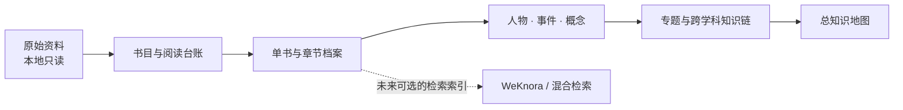

# 人文知识库总控目录

> 以原典为锚，以页码为路标，以关系为地图。

这里保存的是一份持续生长的私人阅读档案：从当代艺术与现代艺术出发，连接现代史、社会学与哲学。它的目标不是替书下结论，而是让每条判断都能回到原文，让不同学科在具体作品、人物和历史条件之间相遇。

## 一、从这里开始

| 需要做什么 | 先看哪里 |
|---|---|
| 接续最近的阅读 | [当前工作状态](当前工作状态.md) |
| 查阅全部藏书与阅读优先级 | [总书目](总书目.md)、[下一批十本候读书单](下一批十本候读书单.md) |
| 查阅《Philosophy and Conceptual Art》 | [整本档案](../01_单书档案/哲学与观念艺术_Goldie-Schellekens_2007_整本阅读档案.md)、[阅读进度](哲学与观念艺术阅读进度.md)、[审美与认知价值](../04_核心概念/观念艺术的审美价值与认知价值.md) |
| 查阅《Recording Conceptual Art: Early Interviews》 | [整本档案](../01_单书档案/观念艺术录音_Norvell-Alberro_2001_整本阅读档案.md)、[逐页进度](Recording%20Conceptual%20Art阅读进度.md)、[传播网络与文献](../04_核心概念/观念艺术的传播网络与文献.md) |
| 判断阅读状态与整理口径 | [阅读进度](阅读进度.md)、[分类规则](分类规则.md) |
| 新建章节或概念笔记 | [章节与词条档案模板](章节与词条档案模板.md) |
| 查找原书推荐资料 | [Further Reading 主题导航](../01_单书档案/Art%20Since%201900%20Further%20Reading目录.md) |
| 查找原书列出的在线资源 | [在线资源目录](../01_单书档案/Art%20Since%201900在线资源目录.md) |
| 核对图像来源与版权署名 | [图版来源索引](../01_单书档案/Art%20Since%201900图版来源索引.md) |
| 查阅《Art in Theory 1900–2000》第二版 | [整本档案](../01_单书档案/Art%20in%20Theory%201900-2000整本阅读档案.md)、[VIII B札记](../01_单书档案/Art%20in%20Theory%201900-2000第八部VIIIB差异的形象.md)、[VIII C札记](../01_单书档案/Art%20in%20Theory%201900-2000第八部VIIIC历史的条件.md)、[书后资料与索引导读](../01_单书档案/Art%20in%20Theory%201900-2000书后资料与索引导读.md) |
| 查阅《开放社会科学：重建社会科学报告书》 | [整本阅读档案](../01_单书档案/开放社会科学_古本根委员会_1997_整本阅读档案.md)、[跨学科性](../04_核心概念/跨学科性.md)、[社会科学学科化知识链](../06_跨学科知识链/社会科学学科化—欧洲中心主义批判—多元普遍主义.md) |
| 查阅《历史资本主义》 | [整本阅读档案](../01_单书档案/历史资本主义_华勒斯坦_1999_整本阅读档案.md)、[无休止积累](../04_核心概念/历史资本主义与无休止积累.md)、[核心—边缘与不平等交换](../04_核心概念/世界经济的核心—边缘与不平等交换.md)、[世界经济—知识秩序—艺术制度](../06_跨学科知识链/资本主义世界经济—知识秩序—艺术制度.md) |
| 查阅《文化生产：媒体与都市艺术》 | [整本阅读档案](../01_单书档案/文化生产_戴安娜克兰_整本阅读档案.md)、[媒介产业—都市艺术世界—受众阐释](../06_跨学科知识链/媒介产业—都市艺术世界—受众阐释.md)、[阅读定位台账](文化生产阅读进度.md) |
| 查阅《文化工业：大众文化论文选》 | [整本阅读档案](../01_单书档案/文化工业_阿多诺_伯恩斯坦编_整本阅读档案.md)、[阅读页码台账](文化工业阅读进度.md)、[交换逻辑—媒介生产—闲暇经验—艺术批判](../06_跨学科知识链/交换逻辑—媒介生产—闲暇经验—艺术批判.md) |
| 查阅《六年：1966至1972年艺术的去物质化》 | [整本阅读档案](../01_单书档案/六年_露西利帕德_整本阅读档案.md)、[阅读进度与页码台账](六年阅读进度.md)、[观念艺术去物质化—信息传播—艺术制度](../06_跨学科知识链/观念艺术去物质化—信息传播—艺术制度.md) |
| 回看中国现代化史第一卷 | [整本阅读档案](../01_单书档案/中国现代化史第一卷整本阅读档案.md)、[第二十二章读书卡](../01_单书档案/中国现代化史第一卷第二十二章国民党政权在大陆的衰败.md)、[目录地图](../01_单书档案/中国现代化史第一卷目录地图.md) |
| 处理新书 PDF、Word 与知识库归档 | [知识库建设规则](知识库建设规则.md) |
| 从英文词头回查书内页码 | [总索引使用指南](../01_单书档案/Art%20Since%201900总索引使用指南.md) |
| 了解原件保护、证据等级和笔记格式 | [知识库建设规则](知识库建设规则.md) |
| 按年度查看《Art Since 1900》阅读位置 | [页码阅读追踪](Art%20Since%201900页码阅读追踪.md) |
| 了解 WeKnora 与检索接入建议 | [WeKnora 接入评估](WeKnora接入评估.md) |

## 二、档案地图

```text
00_项目管理       目录、书目、阅读状态、页码与维护规则
01_单书档案       读过的书与章节笔记；保留原文定位
02_人物知识库     思想家、社会学家、艺术家与历史人物
03_历史事件       事件、社会背景、影响与证据
04_核心概念       概念定义、思想家差异与艺术关联
05_专题档案       由一个清晰问题组织的研究记录
06_跨学科知识链   历史—社会—理论—艺术之间的可追溯关系
12_知识地图       全库脉络与重点入口
13_结构化数据     稳定实体ID和少量有来源的关系
```



## 三、四条阅读经纬

- **艺术**：现代艺术、当代艺术、艺术家、运动、展览、媒介与制度。
- **历史**：世界现代史、中国近现代史、战争、革命、工业化、城市化与全球化。
- **社会**：阶层、劳动、消费、身份、性别、媒介、技术和公共生活。
- **思想**：哲学、社会理论、精神分析、美学、政治思想与思想史。

知识链只在原文和跨书证据足够时建立，常用路径为：

**历史事件 → 社会结构变化 → 思想回应 → 文化观念 → 艺术实践与作品**

## 四、怎样检索与续写

1. 每轮先读“当前工作状态”和“知识库建设规则”，不必重载整本书档案。
2. 研究具体问题时，按书名、章节、人物或概念检索，只打开相关短档案和必要原文位置。
3. 中文是正文主语言；重要原始概念、作品名和运动名在首次出现时保留英文原词，方便检索与核对。
4. 单书档案注明书内页码与PDF页码。区分作者观点、文本概括、跨书比较和进一步推演。
5. 完成一篇后再更新阅读台账、页码索引、相关概念、知识地图和本状态文件。

## 五、当前进度

- 整本读完：15本；部分阅读：0本。最近完成《Recording Conceptual Art: Early Interviews》；详见[整本档案](../01_单书档案/观念艺术录音_Norvell-Alberro_2001_整本阅读档案.md)与[阅读进度台账](Recording%20Conceptual%20Art阅读进度.md)。
- 已整本核读并归档：《20世纪60年代西方文化运动》《科学革命的结构》（第四版）、《六十年代》与《中国现代化史》第一卷。
- 《Art Since 1900》全900页已读完：含五篇方法论导论、130篇正文条目、两篇圆桌讨论、年代索引与时间轴、Glossary、Further Reading、在线资源、图版来源与全书Index。
- 《中国现代化史》第一卷（2006年版序、目录、总论pp.001–026、正文22章pp.027–528、后记pp.529–530、2006年版鸣谢p.531）已整本阅读并归档。《Art in Theory 1900–2000》第二版也已整本阅读，见整本档案、分部札记和书后索引导读。
- 《Art in Theory》本地文件名仍写1900–1990，但用户确认目标为1900–2000第二版；全书正文与书后资料已核读完成。PDF前四页及末两页含改写包装，版本核验记录与整本档案注明了来源边界。
- 《开放社会科学：重建社会科学报告书》1997年三联书店版已整本核读；扫描PDF p.1–119均已检查，报告正文书内pp.1–113 / PDF pp.9–116，PDF pp.117–118为出版社书目广告、p.119为空白。见[整本档案](../01_单书档案/开放社会科学_古本根委员会_1997_整本阅读档案.md)。
- WeKnora：已读用户提供的 v0.8.0 仓库与部署手册，并对照腾讯官方仓库；本机尚无 WeKnora 服务连接，也未安装或部署。

## 六、目录与版本边界

GitHub 私有仓库保存经整理的阅读档案、书目索引和机器可读关系；原始书籍仍在原位置只读。上传和索引不代表原始全文已公开或已读。旧关系中没有 `status` 的记录继续视为历史数据，不自动升级为已核验。

### 《历史资本主义》

1999年中译本及扫描件所附英语文本段均已完整核读，覆盖PDF pp.1–248；中文正文、附录与英语文本分层记录，空白页及标题页单独核验。见[整本阅读档案](../01_单书档案/历史资本主义_华勒斯坦_1999_整本阅读档案.md)。

| 续读下一本 | 开始下一候读项《Documents of Doubt》前，先核对本地PDF版本与页码；完整路线见[候读书单](下一批十本候读书单.md)。 |
