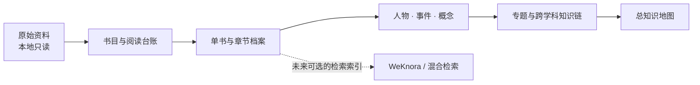

# 人文知识库总控目录

> 以原典为锚，以页码为路标，以关系为地图。

这里保存的是一份持续生长的私人阅读档案：从当代艺术与现代艺术出发，连接现代史、社会学与哲学。它的目标不是替书下结论，而是让每条判断都能回到原文，让不同学科在具体作品、人物和历史条件之间相遇。

## 一、从这里开始

| 需要做什么 | 先看哪里 |
|---|---|
| 查阅第08本周保松《自由人的平等政治》 | [整本档案](../01_单书档案/自由人的平等政治_周保松_2010_整本阅读档案.md)、[阅读进度](自由人的平等政治阅读进度.md)、[跨学科知识链](../06_跨学科知识链/自由平等—社会合作—制度分配—公民文化.md) |
| 查阅第09本《恋人絮语》（整本读完；导读跨版补读） | [整本档案](../01_单书档案/恋人絮语_罗兰巴特_汪耀进武佩荣译_1998_整本阅读档案_跨版补读.md)、[阅读进度](恋人絮语阅读进度.md)、[跨学科知识链](../06_跨学科知识链/恋人话语—符号解释—身体经验—公共语言.md) |
| 查阅第10本柄谷行人《作为隐喻的建筑》 | [整本阅读档案](../01_单书档案/作为隐喻的建筑_柄谷行人_应杰译_2011_整本阅读档案.md)、[阅读进度](作为隐喻的建筑阅读进度.md)、[跨学科知识链](../06_跨学科知识链/形式体系—城市实践—交换关系—社会性外部.md) |
| 查阅第五批第02本奥尔巴赫《摹仿论》 | [整本档案](../01_单书档案/奥尔巴赫_摹仿论_整本阅读档案.md)、[阅读进度](奥尔巴赫摹仿论阅读进度.md)、[人物页](../02_人物知识库/Erich%20Auerbach.md)、[跨学科知识链](../06_跨学科知识链/文学再现—文体等级—社会经验—历史意识.md)；下一本为第五批第03本卡尔维诺《收藏沙子的旅人》 |
| 查阅第五批第03本卡尔维诺《收藏沙子的旅人》 | [整本档案](../01_单书档案/卡尔维诺_收藏沙子的旅人_整本阅读档案.md)、[阅读进度](卡尔维诺收藏沙子阅读进度.md)、[人物页](../02_人物知识库/Italo%20Calvino.md)、[跨学科知识链](../06_跨学科知识链/物件—分类—记忆—想象的世界.md)；第五批第04本梅洛-庞蒂扫描本已读完 |
| 查阅第五批第04本梅洛-庞蒂《可见的与不可见的》 | [整本档案](../01_单书档案/可见的与不可见的_梅洛庞蒂_整本阅读档案.md)、[阅读进度](梅洛庞蒂可见的与不可见的阅读进度.md)、[人物页](../02_人物知识库/Maurice%20Merleau-Ponty.md)、[跨学科知识链](../06_跨学科知识链/知觉信念—肉身—可见性—语言与艺术.md)；扫描本pp.1–295已读完，原作者计划未完成；其后第05本布朗肖《文学空间》已整本读完 |
| 查阅第五批第05本布朗肖《文学空间》 | [整本档案](../01_单书档案/文学空间_布朗肖_整本阅读档案.md)、[阅读进度](布朗肖文学空间阅读进度.md)、[人物页](../02_人物知识库/Maurice%20Blanchot.md)、[跨学科链](../06_跨学科知识链/文学空间—写作主体撤离—死亡经验—阅读生成.md)；扫描本pp.1–297已读完 |
| 查阅第五批第06本德勒兹《普鲁斯特与符号》 | [整本档案](../01_单书档案/德勒兹_普鲁斯特与符号_整本阅读档案.md)、[阅读进度](德勒兹普鲁斯特与符号阅读进度.md)、[人物页](../02_人物知识库/Gilles%20Deleuze.md)、[跨学科链](../06_跨学科知识链/符号相遇—受迫阐释—艺术生产—多重世界.md)；项目扫描PDF pp.1–194已读完 |
| 查阅第五批第07本赵毅衡《符号学：原理与推演（修订本）》 | [整本档案](../01_单书档案/赵毅衡_符号学原理与推演_2016修订本_整本阅读档案.md)、[阅读进度](赵毅衡符号学原理与推演阅读进度.md)、[人物页](../02_人物知识库/赵毅衡.md)、[跨学科链](../06_跨学科知识链/符号文本—身份—消费—现代性.md)；PDF pp.1–426已读完 |
| 查阅第五批第08本《社会符号学》 | [整本档案](../01_单书档案/社会符号学_霍奇克雷斯_2012_整本阅读档案.md)、[阅读进度](社会符号学阅读进度.md)、[人物页](../02_人物知识库/Robert%20Hodge.md) · [Gunther Kress](../02_人物知识库/Gunther%20Kress.md)、[跨学科链](../06_跨学科知识链/社会关系—符号形式—模态判断—主体训练.md)；PDF pp.1–287已读完 |
| 查阅第六批第01项戈夫曼《日常生活中的自我表演》 | [整本档案](../01_单书档案/日常生活中的自我表演_欧文戈夫曼_徐江敏译_1988_整本阅读档案.md)、[阅读进度](日常生活中的自我表演阅读进度.md)、[人物页](../02_人物知识库/欧文·戈夫曼.md)、[跨学科链](../06_跨学科知识链/互动秩序—观众边界—艺术表演与摄影呈现.md)；PDF pp.1–253已读完 |
| 查阅第六批第02项维特鲁威《建筑十书》 | [整本档案](../01_单书档案/建筑十书_维特鲁威_陈平译_2012_整本阅读档案.md)、[阅读进度](建筑十书阅读进度.md)、[跨学科链](../06_跨学科知识链/古典建筑知识—材料技术—城市公共生活.md) |
| 查阅第六批第03项德勒兹《运动—影像》 | [整本档案](../01_单书档案/德勒兹_运动影像_谢强马月译_2016_整本阅读档案.md)、[阅读进度](运动—影像阅读进度.md)、[跨学科链](../06_跨学科知识链/运动—影像—剪辑—知觉—思想.md) |
| 查阅第六批第04项德勒兹《时间—影像》 | [整本档案](../01_单书档案/德勒兹_时间影像_谢强蔡若明马月译_2004_整本阅读档案.md)、[阅读进度](时间—影像阅读进度.md)、[人物页](../02_人物知识库/Gilles%20Deleuze.md)、[跨学科链](../06_跨学科知识链/时间—影像—记忆—声音—电影思维.md) |
| 查阅第六批第05项《艺术与解构——德里达中期艺术哲学批判疏论》 | [整本档案](../01_单书档案/德里达_艺术与解构_张振东冯俊_2018_整本阅读档案.md)、[进度](艺术与解构阅读进度.md)、[德里达人物页](../02_人物知识库/Jacques%20Derrida.md)、[跨学科链](../06_跨学科知识链/原文字—画框—主体画面—盲者记忆.md) |
| 查阅第六批第06项罗兰·巴特《流行体系》 | [整本档案](../01_单书档案/流行体系_罗兰巴特_敖军译_2016_整本阅读档案.md)、[阅读进度](流行体系阅读进度.md)、[人物页](../02_人物知识库/Roland%20Barthes.md)、[跨学科链](../06_跨学科知识链/时装杂志—服饰符码—身份与身体规范.md)；PDF pp.1–310已读完 |
| 查阅第六批第07项索绪尔《第三次普通语言学教程》 | [整本档案](../01_单书档案/索绪尔_第三次普通语言学教程_屠友祥译_2007_整本阅读档案.md)、[阅读进度](索绪尔第三次普通语言学教程阅读进度.md)、[人物页](../02_人物知识库/Ferdinand%20de%20Saussure.md)、[跨学科链](../06_跨学科知识链/语言系统—差异价值—视觉意义.md)；PDF pp.1–213已读完 |
| 查阅第六批第08项皮尔士《皮尔士论符号》 | [整本档案](../01_单书档案/皮尔士_论符号_胡普斯编_徐鹏译_整本阅读档案.md)、[阅读进度](皮尔士论符号阅读进度.md)、[人物页](../02_人物知识库/Charles%20Sanders%20Peirce.md)、[跨学科链](../06_跨学科知识链/符号三元关系—推理方法—科学共同体与视觉意义.md)；PDF pp.1–297已读完 |
| 查阅第六批第09项克里斯蒂娃《符号学：符义分析探索集》 | [整本档案](../01_单书档案/克里斯蒂娃_符号学符义分析探索集_整本阅读档案.md)、[阅读进度](符号学符义分析探索集阅读进度.md)、[人物页](../02_人物知识库/Julia%20Kristeva.md)、[跨学科链](../06_跨学科知识链/身体实践—互文文本—成义过程—艺术观看.md)；PDF pp.1–263已核读；第10项《万物的黎明》现已完成 |
| 查阅第六批第10项Graeber与Wengrow *The Dawn of Everything* | [整本档案](../01_单书档案/格雷伯与温格罗_万物的黎明_2021_整本阅读档案.md)、[阅读进度](万物的黎明阅读进度.md)、[人物页](../02_人物知识库/David%20Graeber.md) · [David Wengrow](../02_人物知识库/David%20Wengrow.md)、[跨学科链](../06_跨学科知识链/自由实验—生计与城市—国家形态—历史想象.md)；EPUB印刷页pp.1–673已读完 |
| 查阅第07本《资本的内部：全球化的哲学理论》 | [整本档案](../01_单书档案/资本的内部_斯洛特戴克_2014_整本阅读档案.md) · [页码台账](资本的内部阅读进度.md) · [跨学科知识链](../06_跨学科知识链/地球图景—航海资本—世界内部空间.md) |
| 查阅第五本沟口雄三《中国前近代思想的演变》 | [整本档案](../01_单书档案/中国前近代思想的演变_沟口雄三_1997_整本阅读档案.md)、[逐页台账](中国前近代思想的演变阅读进度.md) |
| 查阅《中国大陆当代文化变迁（1978—1989）》 | [整本档案](../01_单书档案/中国大陆当代文化变迁_陈奎德主编_1991_整本阅读档案.md)、[分篇页码台账](中国大陆当代文化变迁阅读进度.md)、[跨学科知识链](../06_跨学科知识链/1978-1989文化变迁—思想输入—公共论争—艺术话语.md) |
| 续读杨继绳《中国当代社会各阶层分析》 | [全书档案（原件缺页）](../01_单书档案/中国当代社会各阶层分析_杨继绳_2006_全书阅读档案_原件缺页.md)、[逐章页码台账](中国当代社会各阶层分析阅读进度.md)、[跨学科知识链](../06_跨学科知识链/阶层结构—资源分配—文化生产与艺术制度.md) |
| 接续最近的阅读 | [当前工作状态](当前工作状态.md) |
| 查阅《1945年以来的艺术运动》 | [整本档案](../01_单书档案/1945年以来的艺术运动_爱德华露西史密斯_2016_整本阅读档案.md)、[进度台账](1945年以来的艺术运动阅读进度.md)、[中心迁移概念](../04_核心概念/战后艺术中心迁移与多中心化.md)、[跨学科链](../06_跨学科知识链/战后艺术运动—媒介转化—身份政治—全球地方语境.md) |
| 查阅 *One and Five Ideas* | [整本档案](../01_单书档案/One_and_Five_Ideas_Terry_Smith_整本阅读档案.md)、[逐卷台账](One%20and%20Five%20Ideas阅读进度.md)、[三项命题概念卡](../04_核心概念/概念主义的三项命题：观念化与重新观念化.md)、[跨学科链](../06_跨学科知识链/观念化—翻译实践—地方语境—当代艺术多轨并存.md) |
| 查看2026年10月新筛的十本候读书单 | [下一轮候读十本：艺术、技术、图像与叙事](下一轮候读十本_2026-10.md)（第01–06本完成；第07本可辨页已读至PDF p.407/407，另7页待补，暂不计整本完成） |
| 查阅新一轮第08本卢卡奇《小说理论》 | [整本档案](../01_单书档案/小说理论_卢卡奇_燕宏远李怀涛译_2018_整本阅读档案.md)、[阅读进度](小说理论阅读进度.md)、[概念卡](../04_核心概念/史诗总体、先验无家可归与小说反讽（卢卡奇）.md) · [小说时间、回忆与绵延](../04_核心概念/小说时间、回忆与绵延（卢卡奇）.md)、[跨学科链](../06_跨学科知识链/史诗总体—现代小说—叙事时间与主体经验.md)；PDF pp.1–170已读完，第09本《小说的艺术》接续 |
| 查阅新一轮第09本昆德拉《小说的艺术》 | [整本档案](../01_单书档案/小说的艺术_昆德拉_董强译_2004_整本阅读档案.md)、[阅读进度](小说的艺术阅读进度.md)、[小说存在探询概念卡](../04_核心概念/小说作为存在探询与不确定性智慧（昆德拉）.md)、[形式复调概念卡](../04_核心概念/小说对位法、主题与形式节奏（昆德拉）.md) · [跨学科链](../06_跨学科知识链/存在探询—小说形式—欧洲记忆.md)；PDF pp.1–217已读完 |
| 查阅新一轮第10本乌纳穆诺《生命的悲剧意识》 | [整本档案](../01_单书档案/乌纳穆诺_生命的悲剧意识_段继承译_2007_整本阅读档案.md)、[阅读进度](生命的悲剧意识阅读进度.md)、[人物页](../02_人物知识库/米格尔·德·乌纳穆诺.md)、三张[概念卡](../04_核心概念/生命的悲剧意识：理性、信仰与不朽渴望（乌纳穆诺）.md)及[跨学科链](../06_跨学科知识链/个体不朽渴望—悲剧信仰—吉诃德行动—语言共同体.md)；PDF pp.1–439已读完并适配 |
| 查阅后续候读路线第02本Max Haiven *Art After Money, Money After Art* | [阅读进度](金钱之后的艺术阅读进度.md)；项目英文PDF 305页、16份Word页标连续；PDF pp.1–305已读完，注释与索引均覆盖 |
| 查阅后续候读路线第03本德勒兹、加塔利《千高原》 | [整本档案](../01_单书档案/德勒兹与加塔利_千高原_姜宇辉译_2010_整本阅读档案.md)、[阅读进度](千高原阅读进度.md)、[概念卡](../04_核心概念/根茎、多元体与绘图式知识（千高原）.md) · [跨学科链](../06_跨学科知识链/根茎—组装—迭奏曲：知识与艺术的生成.md)；项目PDF pp.1–776已读完，20份主书Word连续 |
| 查阅后续候读路线第04本海德格尔《在通向语言的途中》 | [整本档案](../01_单书档案/马丁海德格尔_在通向语言的途中_孙周兴译_2004修订本_整本阅读档案.md)、[阅读进度](海德格尔在通向语言的途中阅读进度.md)、[人物页](../02_人物知识库/Martin%20Heidegger.md)、[概念卡](../04_核心概念/道说、语言本己与世界显现（海德格尔）.md) · [跨学科链](../06_跨学科知识链/语言—道说—口令：显现与社会行动.md)；项目PDF pp.1–290已读完，八份Word页标连续；之后多尔迈《主体性的黄昏》、黑格尔《逻辑学》均已完成归档 |
| 查阅后续候读路线第05本多尔迈《主体性的黄昏》 | [整本档案](../01_单书档案/主体性的黄昏_多尔迈_万俊人朱国钧吴海针译_1992_整本阅读档案.md)、[阅读进度](主体性的黄昏阅读进度.md)、[作者页](../02_人物知识库/Fred%20R.%20Dallmayr.md)、[概念卡](../04_核心概念/后个体主义与交互主体性（多尔迈）.md) · [跨学科链](../06_跨学科知识链/主体性—交互主体性—共同世界—社会组织.md)；项目PDF pp.1–454已整本读完，12份Word页标连续。随后第06项黑格尔《逻辑学》已整本读完并归档。
| 查阅后续候读路线第06项黑格尔《逻辑学》（杨一之译，上、下卷） | [整本档案](../01_单书档案/黑格尔_逻辑学_杨一之译_上下卷_整本阅读档案.md)、[阅读进度](黑格尔逻辑学阅读进度.md)、[作者页](../02_人物知识库/Georg%20Wilhelm%20Friedrich%20Hegel.md)、[概念卡](../04_核心概念/反思规定：同一、差异、对立与矛盾（黑格尔）.md) · [跨学科链](../06_跨学科知识链/概念—尺度—客观性—自由：黑格尔《逻辑学》的跨学科接口.md)；上、下卷PDF共1022页已读完。 |
| 查阅后续候读路线第04项郑观应《盛世危言》 | [整本档案](../01_单书档案/郑观应_盛世危言_辛俊玲评注_2002_整本阅读档案.md)、[阅读进度](盛世危言阅读进度.md)、[人物页](../02_人物知识库/郑观应.md) · [评注者](../02_人物知识库/辛俊玲.md)、[概念卡组](../04_核心概念/道器与经世之学：学习新器还须改制（郑观应）.md)、[跨学科链](../06_跨学科知识链/改革—教养—制造—商战—国防：晚清富强论的实践链条.md)；项目PDF pp.1–649已整本读完。 |
| 查阅后续候读路线第05项罗志田、葛小佳《东风与西风》（受限阅读） | [受限档案](../01_单书档案/东风与西风_罗志田葛小佳_1998_受限阅读档案_扫描缺页.md) · [阅读进度](东风与西风阅读进度.md)；现存扫描PDF pp.1–291已读，书内页码缺漏，不计整本完成。 |
| 查阅后续候读路线第06项《毛泽东的中国及后毛泽东的中国》 | [整本档案](../01_单书档案/毛泽东的中国及后毛泽东的中国_迈斯纳_1989中译本_整本阅读档案.md) · [阅读进度](毛泽东的中国及后毛泽东的中国阅读进度.md)；项目PDF pp.1–622已读完，1989年中译本题名页与版权页已核。 |
| 续读后续候读路线第07项《中国现代学术经典·梁漱溟卷》 | [阅读进度](梁漱溟卷阅读进度.md)；项目PDF pp.1–920/951已读，24份Word页标连续，下一页p.921。 |
| 查阅后续候读路线第01本赫尔曼·巴尔《表现主义》 | [整本档案](../01_单书档案/赫尔曼巴尔_表现主义_徐菲译_1989_整本阅读档案.md)、[阅读进度](表现主义阅读进度.md)、[人物页](../02_人物知识库/赫尔曼·巴尔.md)、三张[概念卡](../04_核心概念/精神之眼与内在观看：表现主义（巴尔）.md)及[跨学科链](../06_跨学科知识链/观看方式—内在图像—表现主义—世界认识.md)；PDF pp.1–193已读完，译者序、巴尔正文和两篇附录分层记录 |
| 查阅新一轮十本第03本门格尔《国民经济学原理》 | [整本档案](../01_单书档案/卡尔门格尔_国民经济学原理_整本阅读档案.md)、[阅读进度](国民经济学原理阅读进度.md)、[人物页](../02_人物知识库/卡尔·门格尔.md)、[跨学科链](../06_跨学科知识链/财货稀缺—主观价值—生产互补—艺术市场.md)；PDF pp.1–288已读完并归档 |
| 查阅新一轮十本第04本 *Artists Re:Thinking the Blockchain* | [整本档案](../01_单书档案/Artists_ReThinking_the_Blockchain_整本阅读档案.md)、[阅读进度](Artists%20ReThinking%20the%20Blockchain阅读进度.md)、[7张概念卡](../04_核心概念/FinBook与文化价值的代币化实验.md)、[跨学科链](../06_跨学科知识链/分布式账本—市场化治理—文化劳动—艺术流通.md)；PDF pp.1–345已整本读完 |
| 查阅新一轮十本第05本《伊甸园之门：六十年代的美国文化》 | [整本档案](../01_单书档案/伊甸园之门_莫里斯迪克斯坦_方晓光译_2007_整本阅读档案.md)、[阅读进度](伊甸园之门阅读进度.md)、[人物页](../02_人物知识库/莫里斯·迪克斯坦.md)、[跨学科链](../06_跨学科知识链/冷战规范—青年反叛—文化形式—历史记忆.md)；PDF pp.1–333已读完 |
| 查阅新一轮十本第06本萨特《想象》 | [整本档案](../01_单书档案/萨特_想象_杜小真译_2014_整本阅读档案.md)、[阅读进度](想象阅读进度.md)、[人物页](../02_人物知识库/Jean-Paul%20Sartre.md)、[概念卡](../04_核心概念/影像意识不是物：萨特《想象》的意向性论.md)、[跨学科链](../06_跨学科知识链/知觉—心像—意向对象—艺术图像媒介.md)；PDF pp.1–214已读完 |
| 查看新增候读储备十本 | [图像、观念与货币](候读储备十本_图像观念与货币_2026-10.md)（本地PDF与Word分卷已核；不改变现行阅读顺序） |
| 查看后续候读十本 | [艺术思想与中国现代性](下一批候读十本_艺术思想与中国现代性_2026-10.md)（项目PDF与Word页标已核；排在现行阅读路线之后） |
| 查看补充候读十本：文学、图像与经济思想 | [候读路线](补充候读十本_文学图像与经济思想_2026-10.md)（第01本《堂吉诃德》已整本读完；[整本档案](../01_单书档案/塞万提斯_堂吉诃德_杨绛译_整本阅读档案.md)、[逐页台账](堂吉诃德杨绛译阅读进度.md)、[跨学科链](../06_跨学科知识链/叙事虚构—现实行动—印刷传播—公共身份.md)） |
| 查阅《表现主义论争》 | [整本档案](../01_单书档案/表现主义论争_张黎编选_1992_整本阅读档案.md)、[页码台账](../01_单书档案/表现主义论争_张黎编选_1992_阅读进度.md)、[跨学科知识链](../06_跨学科知识链/表现主义论争—社会结构—现实主义—人民阵线.md) |
| 查阅《文艺心理学》 | [整本阅读档案](../01_单书档案/文艺心理学_朱光潜_1996_整本阅读档案.md)、[阅读进度与页码台账](文艺心理学阅读进度.md)、[心理距离概念卡](../04_核心概念/审美经验与心理距离.md) |
| 查阅《灰色的狂欢节：2000年以来的中国当代艺术》 | [整本档案](../01_单书档案/灰色的狂欢节_朱朱_2013_整本阅读档案.md) · [页码台账](../01_单书档案/灰色的狂欢节_朱朱_2013_阅读进度.md) · [市场—身份—形式知识链](../06_跨学科知识链/市场扩张—艺术家身份—形式自主与灰色公共性.md) |
| 查阅《词与物：人文科学的考古学》 | [整本档案](../01_单书档案/词与物_福柯_莫伟民译_2016_整本阅读档案.md)、[页码进度](词与物阅读进度.md)、[知识型](../04_核心概念/知识型与历史先天性.md) |
| 查阅《愤怒与宽恕》 | [整本档案](../01_单书档案/愤怒与宽恕_努斯鲍姆_高忠义译_2017_整本阅读档案.md)、[页码进度](愤怒与宽恕阅读进度.md)、[前瞻式正义](../04_核心概念/前瞻式正义与政治和解.md) |
| 查看候读书单与阅读顺序 | [当前之后的十本：语言、主体与中国现代性](后续候读十本_语言主体与中国现代性_2026-10.md) · [现行十本候读书单](再读十本候读书单_2026-09.md) · [第五批候读十本：文字、图像与社会意义](第五批候读十本_2026-09.md) · [第六批候读十本：社会生活、建筑与符号](第六批候读十本_2026-09.md) · [第四批候读十本](第四批候读十本_2026-09.md) · [首轮书单与阅读记录](下一批十本候读书单.md) · [后续十本储备书单](后续十本候读书单_2026-09.md) · [补充候读书单](后续候读十本_补充书单_2026-09.md) · [第三批候读十本](第三批候读十本_2026-09.md) · [总书目](总书目.md) |
| 查阅《Philosophy and Conceptual Art》 | [整本档案](../01_单书档案/哲学与观念艺术_Goldie-Schellekens_2007_整本阅读档案.md)、[阅读进度](哲学与观念艺术阅读进度.md)、[审美与认知价值](../04_核心概念/观念艺术的审美价值与认知价值.md) |
| 查阅《Recording Conceptual Art: Early Interviews》 | [整本档案](../01_单书档案/观念艺术录音_Norvell-Alberro_2001_整本阅读档案.md)、[逐页进度](Recording%20Conceptual%20Art阅读进度.md)、[传播网络与文献](../04_核心概念/观念艺术的传播网络与文献.md) |
| 查阅《单行道》 | [整本档案](../01_单书档案/单行道_本雅明_2006_整本阅读档案.md)、[阅读进度](单行道阅读进度.md)、[思想意象与短形式](../04_核心概念/思想意象、蒙太奇与短形式写作.md) |
| 查阅补充书单第01项《中国：传统与变革》 | [整本阅读档案](../01_单书档案/中国传统与变革_费正清与赖肖尔_整本阅读档案.md)、[阅读进度](中国传统与变革阅读进度.md) |
| 查阅《中国意识的危机》受限阅读档案 | [正文阅读档案](../01_单书档案/中国意识的危机_林毓生_1986_阅读档案_前言缺页.md)、[页码台账](中国意识的危机阅读进度.md)、[概念卡](../04_核心概念/借思想文化取径与全盘性反传统主义_林毓生.md)、[鲁迅意识卡](../04_核心概念/显示与隐示意识_鲁迅念旧.md)、[跨学科知识链](../06_跨学科知识链/王权秩序崩解—思想模式—文学反传统—创造性转化.md)；前言p.15缺损，未计整本完成 |
| 查阅补充书单第03项夏济安《黑暗的闸门》 | [整本阅读档案](../01_单书档案/黑暗的闸门_夏济安_1968_整本阅读档案.md)、[阅读进度](黑暗的闸门阅读进度.md)、[夏济安人物页](../02_人物知识库/夏济安.md)、[龙华事件档案](../03_历史事件/1931年龙华处决案与左联五烈士.md)、[跨学科知识链](../06_跨学科知识链/文学运动—党派组织—作家主体性—历史记忆.md)；项目PDF pp.1–293已读，中文名映射与五烈士人数异说均有来源边界 |
| 查阅补充书单第04项萧公权《中国政治思想史》（受限阅读） | [受限档案](../01_单书档案/萧公权_中国政治思想史_1998_受限阅读档案_第五编缺文.md)、[逐页台账](中国政治思想史阅读进度.md)、[人物页](../02_人物知识库/萧公权.md)、[概念卡](../04_核心概念/政治思想史分期：创造、因袭、转变、成熟.md)、[跨学科知识链](../06_跨学科知识链/政治秩序—权力结构—民权论争—现代国家.md)；现存扫描PDF pp.1–922已读，但第五编缺文，不计整本完成。 |
| 查阅补充书单第05项岛田虔次《中国思想史研究》 | [整本阅读档案](../01_单书档案/岛田虔次_中国思想史研究_邓红译_2009_整本阅读档案.md)、[阅读进度](中国思想史研究阅读进度.md)、[跨学科知识链](../06_跨学科知识链/士人制度—阳明主体—学校公议—近代政治论争.md)；项目扫描PDF pp.1–493已读完，第二部首篇原计划第三节缺文 |
| 查阅补充书单第06项吉川幸次郎《中国文学史》 | [整本档案](../01_单书档案/吉川幸次郎_中国文学史_整本阅读档案.md)、[阅读进度](中国文学史阅读进度.md)、[跨学科知识链](../06_跨学科知识链/制度变迁—语言文体—出版传播—小说读者.md)；PDF pp.1–265已读完；第07项王元化《文心雕龙创作论》也已整本读完。原路线第08项钱钟书《谈艺录》项目PDF pp.1–662已读完并归档。 |
| 查阅补充书单第07项王元化《文心雕龙创作论》 | [整本档案](../01_单书档案/王元化_文心雕龙创作论_1984_整本阅读档案.md)、[阅读台账](文心雕龙创作论阅读进度.md)、[概念互读](../04_核心概念/联想、想象与整体性.md)、[跨学科知识链](../06_跨学科知识链/社会位置—心物感发—文学形象—创作结构.md)；项目PDF pp.1–326已读完，p.262重复、p.314空白。随后第08项钱钟书《谈艺录》项目PDF pp.1–662已读完并归档。 |
| 查阅补充书单第08项钱钟书《谈艺录》 | [整本档案](../01_单书档案/钱钟书_谈艺录_补订本_整本阅读档案.md)、[阅读进度](谈艺录阅读进度.md)、[人物页](../02_人物知识库/钱钟书.md)、[概念卡](../04_核心概念/诗歌留白与读者补足.md)、[跨学科知识链](../06_跨学科知识链/文本源流—语言形式—读者经验—文学生态.md)；项目PDF pp.1–662及34份Word分卷已核读。 |
| 查阅补充书单第09项柏格森《时间与自由意志》 | [整本档案](../01_单书档案/柏格森_时间与自由意志_吴士栋译_1989_整本阅读档案.md)、[阅读进度](时间与自由意志阅读进度.md)；五份Word页标连续覆盖PDF pp.1–175，全文阅读完成。 |
| 补充书单第10项《见证：肖斯塔科维奇回忆录》（受限阅读） | [阅读档案](../01_单书档案/肖斯塔科维奇_见证_1981_受限阅读档案_末尾附录缺失.md)、[阅读进度](见证肖斯塔科维奇回忆录阅读进度.md)；10份Word页标连续覆盖扫描PDF pp.1–373，现存扫描已读完；目录列书内p.370《伏尔科夫简介》，扫描末页为印刷p.369，待补页。 |
| 查阅《后现代状况》（当前150页部分） | [部分阅读档案](../01_单书档案/后现代状况_利奥塔_150页扫描_部分阅读档案.md)、[阅读进度](后现代状况阅读进度.md)、[合法化危机](../04_核心概念/后现代状况、宏大叙事与合法化危机.md) |
| 查阅《Documents of Doubt: The Photographic Conditions of Conceptual Art》 | [整本档案](../01_单书档案/疑证文件_Heather-Diack_2020_整本阅读档案.md)、[阅读进度](Documents%20of%20Doubt阅读进度.md)、[摄影社会类型](../04_核心概念/摄影社会类型、序列与集体肖像.md) |
| 查阅高千惠《第三翅膀：艺术观念及其不满》 | [整本档案](../01_单书档案/第三翅膀_高千惠_2014_整本阅读档案.md)、[阅读进度](第三翅膀阅读进度.md)、[艺术观念与观念艺术](../04_核心概念/艺术观念与观念艺术.md)、[品味殖民与休闲文化](../04_核心概念/品味殖民与休闲文化.md) |
| 判断阅读状态与整理口径 | [阅读进度](阅读进度.md)、[分类规则](分类规则.md) |
| 新建章节或概念笔记 | [章节与词条档案模板](章节与词条档案模板.md) |
| 查找原书推荐资料 | [Further Reading 主题导航](../01_单书档案/Art%20Since%201900%20Further%20Reading目录.md) |
| 查找原书列出的在线资源 | [在线资源目录](../01_单书档案/Art%20Since%201900在线资源目录.md) |
| 核对图像来源与版权署名 | [图版来源索引](../01_单书档案/Art%20Since%201900图版来源索引.md) |
| 查阅《Art in Theory 1900–2000》第二版 | [整本档案](../01_单书档案/Art%20in%20Theory%201900-2000整本阅读档案.md)、[VIII B札记](../01_单书档案/Art%20in%20Theory%201900-2000第八部VIIIB差异的形象.md)、[VIII C札记](../01_单书档案/Art%20in%20Theory%201900-2000第八部VIIIC历史的条件.md)、[书后资料与索引导读](../01_单书档案/Art%20in%20Theory%201900-2000书后资料与索引导读.md) |
| 查阅Jonathan Fineberg《一九四零年以来的艺术》 | [整本阅读档案](../01_单书档案/一九四零年以来的艺术_费恩伯格_2006_整本阅读档案.md)、[阅读进度](一九四零年以来的艺术阅读进度.md)、[战后生活经验—存在策略—媒介与艺术制度](../06_跨学科知识链/战后生活经验—存在策略—媒介与艺术制度.md) |
| 查阅夏晓虹《晚清女性与近代中国》 | [整本阅读档案](../01_单书档案/晚清女性与近代中国_夏晓虹_2004_整本阅读档案.md)、[阅读进度](晚清女性与近代中国阅读进度.md)、[报刊公共空间—女子教育—女性行动与国家转型](../06_跨学科知识链/报刊公共空间—女子教育—女性行动与国家转型.md) |
| 查阅《开放社会科学：重建社会科学报告书》 | [整本阅读档案](../01_单书档案/开放社会科学_古本根委员会_1997_整本阅读档案.md)、[跨学科性](../04_核心概念/跨学科性.md)、[社会科学学科化知识链](../06_跨学科知识链/社会科学学科化—欧洲中心主义批判—多元普遍主义.md) |
| 查阅《历史资本主义》 | [整本阅读档案](../01_单书档案/历史资本主义_华勒斯坦_1999_整本阅读档案.md)、[无休止积累](../04_核心概念/历史资本主义与无休止积累.md)、[核心—边缘与不平等交换](../04_核心概念/世界经济的核心—边缘与不平等交换.md)、[世界经济—知识秩序—艺术制度](../06_跨学科知识链/资本主义世界经济—知识秩序—艺术制度.md) |
| 查阅《文化生产：媒体与都市艺术》 | [整本阅读档案](../01_单书档案/文化生产_戴安娜克兰_整本阅读档案.md)、[媒介产业—都市艺术世界—受众阐释](../06_跨学科知识链/媒介产业—都市艺术世界—受众阐释.md)、[阅读定位台账](文化生产阅读进度.md) |
| 查阅《文化工业：大众文化论文选》 | [整本阅读档案](../01_单书档案/文化工业_阿多诺_伯恩斯坦编_整本阅读档案.md)、[阅读页码台账](文化工业阅读进度.md)、[交换逻辑—媒介生产—闲暇经验—艺术批判](../06_跨学科知识链/交换逻辑—媒介生产—闲暇经验—艺术批判.md) |
| 查阅《六年：1966至1972年艺术的去物质化》 | [整本阅读档案](../01_单书档案/六年_露西利帕德_整本阅读档案.md)、[阅读进度与页码台账](六年阅读进度.md)、[观念艺术去物质化—信息传播—艺术制度](../06_跨学科知识链/观念艺术去物质化—信息传播—艺术制度.md) |
| 回看中国现代化史第一卷 | [整本阅读档案](../01_单书档案/中国现代化史第一卷整本阅读档案.md)、[第二十二章读书卡](../01_单书档案/中国现代化史第一卷第二十二章国民党政权在大陆的衰败.md)、[目录地图](../01_单书档案/中国现代化史第一卷目录地图.md) |
| 处理新书 PDF、Word 与知识库归档 | [知识库建设规则](知识库建设规则.md) |
| 从英文词头回查书内页码 | [总索引使用指南](../01_单书档案/Art%20Since%201900总索引使用指南.md) |
| 了解原件保护、证据等级和笔记格式 | [知识库建设规则](知识库建设规则.md) |
| 按年度查看《Art Since 1900》阅读位置 | [页码阅读追踪](Art%20Since%201900页码阅读追踪.md) |
| 了解 WeKnora 与检索接入建议 | [WeKnora 接入评估](WeKnora接入评估.md) |

## 二、档案地图

```text
00_项目管理       目录、书目、阅读状态、页码与维护规则
01_单书档案       读过的书与章节笔记；保留原文定位
02_人物知识库     思想家、社会学家、艺术家与历史人物
03_历史事件       事件、社会背景、影响与证据
04_核心概念       概念定义、思想家差异与艺术关联
05_专题档案       由一个清晰问题组织的研究记录
06_跨学科知识链   历史—社会—理论—艺术之间的可追溯关系
12_知识地图       全库脉络与重点入口
13_结构化数据     稳定实体ID和少量有来源的关系
```



## 三、四条阅读经纬

- **艺术**：现代艺术、当代艺术、艺术家、运动、展览、媒介与制度。
- **历史**：世界现代史、中国近现代史、战争、革命、工业化、城市化与全球化。
- **社会**：阶层、劳动、消费、身份、性别、媒介、技术和公共生活。
- **思想**：哲学、社会理论、精神分析、美学、政治思想与思想史。

知识链只在原文和跨书证据足够时建立，常用路径为：

**历史事件 → 社会结构变化 → 思想回应 → 文化观念 → 艺术实践与作品**

## 四、怎样检索与续写

1. 每轮先读“当前工作状态”和“知识库建设规则”，不必重载整本书档案。
2. 研究具体问题时，按书名、章节、人物或概念检索，只打开相关短档案和必要原文位置。
3. 中文是正文主语言；重要原始概念、作品名和运动名在首次出现时保留英文原词，方便检索与核对。
4. 单书档案注明书内页码与PDF页码。区分作者观点、文本概括、跨书比较和进一步推演。
5. 完成一篇后再更新阅读台账、页码索引、相关概念、知识地图和本状态文件。

## 五、当前进度

- 已整本读完81本，7项仍列受限／部分阅读；《语言、主体与中国现代性》路线第01–04、06项均已整本读完并归档。第05项《东风与西风》现存扫描已读但原书页码有缺漏，不计整本完成；第07项《中国现代学术经典·梁漱溟卷》为当前阅读。另一条新一轮候读路线中的《德勒兹：关键概念》仍有7页缺源，按用户要求暂缓寻找。第06项迈斯纳《毛泽东的中国及后毛泽东的中国》项目PDF pp.1–622已完成，见[整本档案](../01_单书档案/毛泽东的中国及后毛泽东的中国_迈斯纳_1989中译本_整本阅读档案.md)与[进度](毛泽东的中国及后毛泽东的中国阅读进度.md)。第04项郑观应《盛世危言》项目PDF pp.1–649已完成，见[整本档案](../01_单书档案/郑观应_盛世危言_辛俊玲评注_2002_整本阅读档案.md)、[进度](盛世危言阅读进度.md)、[人物页](../02_人物知识库/郑观应.md)与[跨学科链](../06_跨学科知识链/改革—教养—制造—商战—国防：晚清富强论的实践链条.md)。
- 已整本核读并归档：《20世纪60年代西方文化运动》《科学革命的结构》（第四版）、《六十年代》与《中国现代化史》第一卷。
- 《Art Since 1900》全900页已读完：含五篇方法论导论、130篇正文条目、两篇圆桌讨论、年代索引与时间轴、Glossary、Further Reading、在线资源、图版来源与全书Index。
- 《中国现代化史》第一卷（2006年版序、目录、总论pp.001–026、正文22章pp.027–528、后记pp.529–530、2006年版鸣谢p.531）已整本阅读并归档。《Art in Theory 1900–2000》第二版也已整本阅读，见整本档案、分部札记和书后索引导读。
- 《Art in Theory》本地文件名仍写1900–1990，但用户确认目标为1900–2000第二版；全书正文与书后资料已核读完成。PDF前四页及末两页含改写包装，版本核验记录与整本档案注明了来源边界。
- 《开放社会科学：重建社会科学报告书》1997年三联书店版已整本核读；扫描PDF p.1–119均已检查，报告正文书内pp.1–113 / PDF pp.9–116，PDF pp.117–118为出版社书目广告、p.119为空白。见[整本档案](../01_单书档案/开放社会科学_古本根委员会_1997_整本阅读档案.md)。
- WeKnora：已读用户提供的 v0.8.0 仓库与部署手册，并对照腾讯官方仓库；本机尚无 WeKnora 服务连接，也未安装或部署。

## 六、目录与版本边界

GitHub 私有仓库保存经整理的阅读档案、书目索引和机器可读关系；原始书籍仍在原位置只读。上传和索引不代表原始全文已公开或已读。旧关系中没有 `status` 的记录继续视为历史数据，不自动升级为已核验。

### 《历史资本主义》

1999年中译本及扫描件所附英语文本段均已完整核读，覆盖PDF pp.1–248；中文正文、附录与英语文本分层记录，空白页及标题页单独核验。见[整本阅读档案](../01_单书档案/历史资本主义_华勒斯坦_1999_整本阅读档案.md)。

| 当前阅读 | 整本读完81本，7项仍受限／部分阅读。第05项《东风与西风》现存扫描已读但缺原书页码；现读第07项《中国现代学术经典·梁漱溟卷》PDF pp.1–920/951，下一页p.921，见[阅读台账](梁漱溟卷阅读进度.md)。第06项《毛泽东的中国及后毛泽东的中国》PDF pp.1–622已整本读完，详见[整本档案](../01_单书档案/毛泽东的中国及后毛泽东的中国_迈斯纳_1989中译本_整本阅读档案.md)与[阅读台账](毛泽东的中国及后毛泽东的中国阅读进度.md)。 |

## 新增：《词与物》——知识秩序、人的出现与人文科学

从文艺复兴相似性到古典表象秩序，再到现代劳动、生命、语言的历史性，福柯分析知识对象与主体位置如何改变。《宫中侍女》以观看关系为入口，人文科学章节则把“人”放回其知识条件中讨论。整本记录与证据边界见[单书档案](../01_单书档案/词与物_福柯_莫伟民译_2016_整本阅读档案.md)、[知识型概念卡](../04_核心概念/知识型与历史先天性.md)及[跨学科知识链](../06_跨学科知识链/知识秩序—情绪判断—制度正义.md)。

## 新增：《愤怒与宽恕》——报复、法律与面向未来的正义

努斯鲍姆分别检视愤怒的偿还/地位路径、转化的愤怒、宽恕系谱和亲密—日常—政治三个领域。南非真相与和解委员会是有限历史语境中的案例，不作为普遍制度模板。见[单书档案](../01_单书档案/愤怒与宽恕_努斯鲍姆_高忠义译_2017_整本阅读档案.md)、[阅读进度](愤怒与宽恕阅读进度.md)及[事件档案](../03_历史事件/南非真相与和解委员会：事实承认与政治和解.md)。
