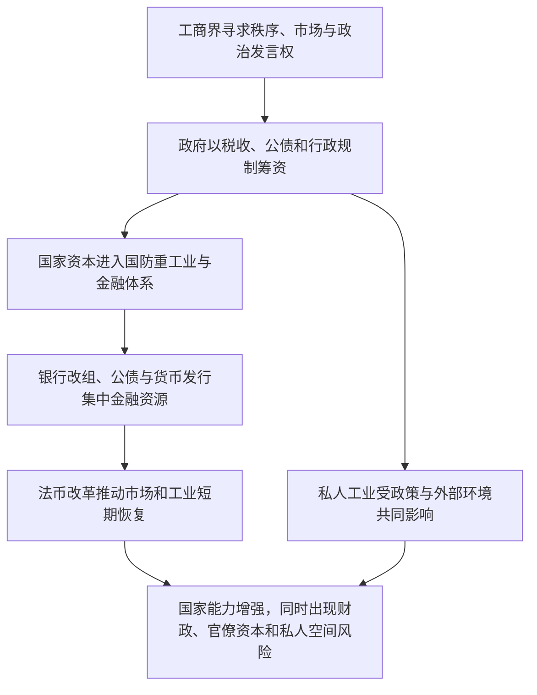

# 中产阶级—国家资本—金融控制—法币改革与工业化

> 一条据施正中《中国现代化史》第一卷第十六章建立的经济史线索：南京政府如何在工商界、财政、银行、货币与重工业之间调配资源。箭头表示作者组织的论述关系，不等同于单一因果链。

## 证据节点

| 环节 | 书内 / PDF页码 | 本章呈现 |
|---|---|---|
| 工商界期待秩序与代表性 | pp.373–374 / pp.389–390 | 中产阶级支持统一和稳定的政府，但很快面对筹资压力、劳资管制与政治参与受限 |
| 民间工业的起伏 | pp.375–378 / pp.391–394 | 关税、厘金、市场、抵制日货、白银流动及战争共同影响私人工业；繁荣与衰退并非只由企业自身决定 |
| 国家资本与国防工业 | pp.379–382 / pp.395–398 | 资源委员会借助调查、计划、外资和技术合作，尝试在内地建设重工业；战争阻断多项计划 |
| 银行改组与金融控制 | pp.383–385 / pp.399–401 | 公债改变银行的资金配置，金融危机和增资改组扩大国家金融资本，也带来金融与产业关系紧张 |
| 法币改革与经济恢复 | pp.386–393 / pp.402–409 | 统一货币与集中外汇后，市场、信用和工业活动恢复；政府金融控制和长期财政风险亦同步扩展 |

## 论述路径

## 跨学科入口

- **经济史**：市场扩张与政治秩序之间如何互相影响？私人资本增长为何会受公债、税制和国际商品价格左右？
- **财政史与国家能力**：国家能否筹集资金、组织重工业、稳定货币，与其政治统治权威如何相连？
- **社会学**：工商团体既需要政府提供秩序，又会因强制筹资与代表权受限而与政府冲突。
- **技术与知识史**：资源委员会的调查、规划、外国技术合作和专业人才如何把知识转为国家建设能力？
- **比较现代化研究**：国家投资可以弥补私人资本的限制，也可能把信贷和资源配置权集中于官僚体系；效果需要按行业和制度条件分别考察。

## 解释边界

本链仅概括施正中一章，未对各行业统计、银行案例、企业档案和政策效果进行独立量化复核。关于国家资本的两面性是章节内部的历史解释，不构成“干预越多越有效”或“市场越自由越现代”的普遍规律。

## 相关档案

- [第十六章读书卡](../01_单书档案/中国现代化史第一卷第十六章南京政府的十年经济.md)
- [国家资本概念卡](../04_核心概念/国家资本（施正中第十六章视角）.md)
- [1935年法币改革事件卡](../03_历史事件/1935年法币改革（施正中第十六章视角）.md)
- [第十五章读书卡](../01_单书档案/中国现代化史第一卷第十五章国民政府权威的建立与困境.md)
