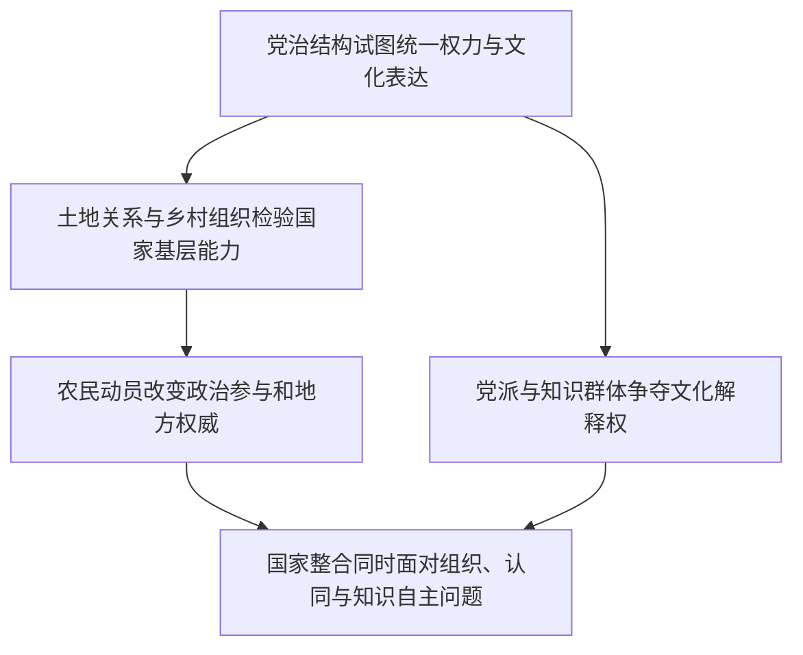

# 党治文化—主体文化—文化主体与国家整合

> 一条据《中国现代化史》第一卷第十五、十七、十八章建立的来源限定线索：政党如何组织国家、乡村社会与文化表达，社会群体又如何回应这种组织。

## 证据节点

| 环节 | 章节位置 | 证据与问题 |
|---|---|---|
| 党治国家的制度化 | 第十五章，书内pp.351–372 / PDF pp.367–388 | 高华讨论党、政府和军队的组织关系、党化宣传、行政控制及专家参与的边界 |
| 乡村基层权威与土地 | 第十七章，书内pp.393–414 / PDF pp.409–430 | 张益民比较国民政府的乡村渗透、土地政策与中共根据地的农民组织；目录起页和正文标题页存在一页差异 |
| 文化表达与政治主体 | 第十八章，书内pp.415–437 / PDF pp.431–453 | 党治文化、左翼大众化和自由知识分子论争，围绕谁能代表、创造并传播文化展开 |
| 国家整合的社会基础 | 第十五至十八章 | 行政和宣传可以加强国家的组织能力，但基层参与、社会认同与知识自主还取决于具体的利益、制度和权力关系 |

## 论述路径

## 跨学科入口

- **政治学**：党、政府、军队和社会组织的边界如何影响权力制衡与国家能力？
- **社会史**：土地、租佃、士绅网络和农民组织如何构成基层政治的现实基础？
- **思想史与传播史**：党化文化、大众化文艺与独立知识分子之间如何争夺文化主体位置？
- **艺术与文学研究**：本章涉及左翼文学及文艺大众化的理论争论；具体作品的形式、受众和传播效果仍需作品与刊物证据支持。

## 解释边界

此链将不同章节的论点并置回看，作者之间的观点仍各自归属。箭头表示可互相追问的结构关系，不声称国家组织、土地改革和文化运动构成必然单线因果。

## 关联档案

- [第十五章读书卡](../01_单书档案/中国现代化史第一卷第十五章国民政府权威的建立与困境.md)
- [第十七章读书卡](../01_单书档案/中国现代化史第一卷第十七章现代化变迁中的土地改革.md)
- [第十八章读书卡](../01_单书档案/中国现代化史第一卷第十八章主体文化与文化主体的颠覆.md)
- [党治国家概念卡](../04_核心概念/党治国家（高华第十五章视角）.md)
- [主体文化与文化主体概念卡](../04_核心概念/主体文化与文化主体（本书第十八章视角）.md)
