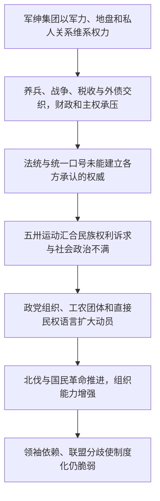

# 军绅政治—财政依附—权威危机—国民革命

> 一条据王跃《中国现代化史》第一卷第十四章建立的来源限定线索：国家权力、财政资源、民族自主和社会动员如何在北洋末期交汇。箭头表示作者的论述关系，不宣称单一、必然的因果链。

## 证据节点

| 环节 | 书内 / PDF页码 | 本章呈现 |
|---|---|---|
| 军绅集团争夺权力与资源 | pp.329–335 / pp.345–351 | 军事力量与私人关系网络联结，政治、行政和财政被集团竞争牵动；士兵生计、军饷和地盘也是组织基础 |
| 法统与统一难以形成共同权威 | pp.336–342 / pp.352–358 | 约法、国会、宪法和统一口号屡被不同集团调用；外债与军事依赖加剧民族自主和合法性争议 |
| 五卅运动扩大社会动员 | pp.343–346 / pp.359–362 | 反帝、废约和租界问题与对北洋政治的不满交织，城市群体及多地响应进入政治行动 |
| 政党组织与国民革命 | pp.347–350 / pp.363–366 | 国民党改组、国共合作与工农组织为动员提供制度形式；北伐推进，同时暴露领袖依赖和联盟分裂风险 |

## 论述路径

## 跨学科入口

- **政治学**：政权控制力、法律形式与社会承认的权威之间有何差异？
- **财政史**：持续战争怎样改变税收、外债和中央—地方关系？
- **社会学**：私人依附网络与现代政党、工会、农会等组织有何不同？
- **民族主义研究**：反帝要求如何同国内的政治参与和国家合法性问题相连？
- **艺术与文化史**：本章未提供艺术实践证据；待后续材料出现后再建立直接联系。

## 解释边界

本链只整理王跃一章内部的论证，并借第十二、十三章标示同卷互读入口；尚未对军阀政治、五卅运动、国民革命史的不同解释进行比较。不能把“外债—运动—革命”压缩成机械因果，也不能用城市民意调查代表全国所有群体。

## 关联档案

- [第十四章读书卡](../01_单书档案/中国现代化史第一卷第十四章军绅政权和国民革命.md)
- [军绅政权概念卡](../04_核心概念/军绅政权（王跃本章视角）.md)
- [五卅运动事件卡](../03_历史事件/五卅运动（王跃第十四章视角）.md)
- [国民革命事件卡](../03_历史事件/国民革命（王跃第十四章视角）.md)
- [第十二章北洋政府时期的经济](../01_单书档案/中国现代化史第一卷第十二章北洋政府时期的经济.md)
- [第十三章“五四”后的社会文化思潮](../01_单书档案/中国现代化史第一卷第十三章五四后的社会文化思潮.md)
