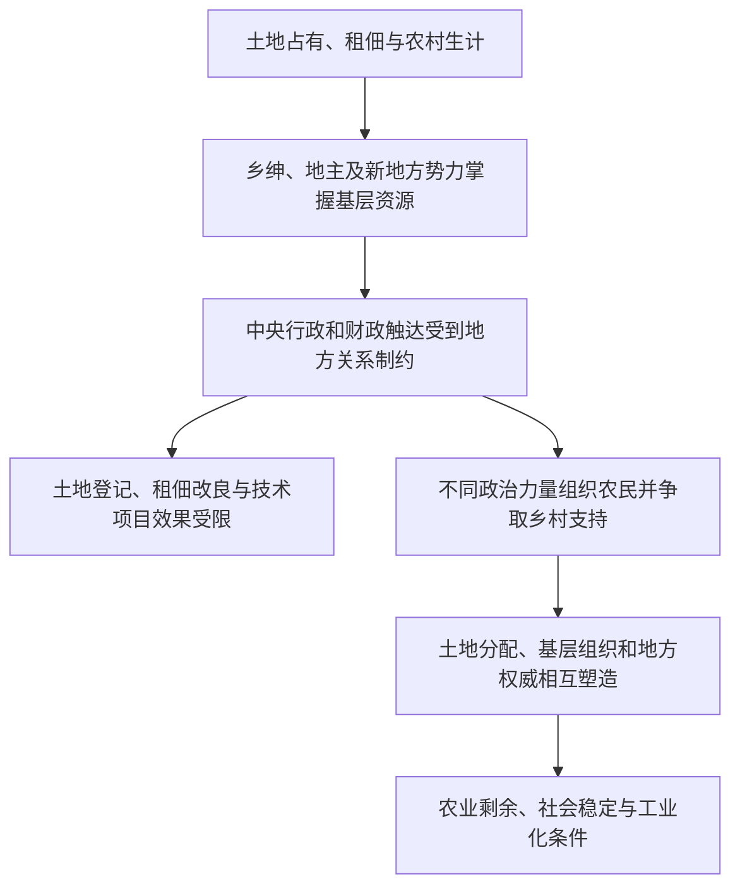

# 土地关系—地方权威—农民动员—国家整合

> 一条据张益民《中国现代化史》第一卷第十七章建立的来源限定线索，并与前面国家建设章节互读：土地制度既关乎农业生产，也影响地方权力、基层组织与国家整合。

## 证据节点

| 环节 | 章节位置 | 本章材料 |
|---|---|---|
| 土地关系与乡村危机 | 第十七章，书内pp.393–396 / PDF pp.409–412 | 土地占有、田赋、租佃和人口压力共同构成乡村改革背景；作者强调国家权威是改革实施的前提 |
| 行政渗透与地方精英 | 第十七章，书内pp.394–401 / PDF pp.410–417 | 基层人员、财政与治安能力不足，地方豪绅影响土地登记、减租和政策执行 |
| 农民动员与土地革命 | 第十七章，书内pp.402–407 / PDF pp.418–423 | 中共在根据地将土地分配、农会、基层政权和政治动员相连，并调整政策以处理农民所有权与生产问题 |
| 乡村改良的多种道路 | 第十七章，书内pp.408–414 / PDF pp.424–430 | 平民教育、乡村建设、合作与村公有等实验呈现地方权威、资源和土地结构的限制 |
| 工业化与农业基础 | 第十六章，书内pp.373–392 / PDF pp.389–408 | 民间工业、国家资本和财政资源如何与农村经济、农业剩余及农村购买力发生联系 | 

## 论述路径

## 跨学科入口

- **政治社会学**：地方行政、士绅网络和基层武装如何影响国家权力的实际范围？
- **经济史**：土地权利、租佃关系和农业剩余怎样影响工业资本形成、农村市场与家庭生计？
- **组织研究**：学校、合作社、农会、土地委员会和基层政权各自如何动员村民？
- **知识与发展史**：教育、卫生、水利、农业技术等项目在何种条件下能改善生活，何时会被地方权力关系吸收？

## 解释边界

本链只整理张益民一章的比较框架，并与施正中第十六章作问题互读。各地土地制度、阶级关系与政治组织存在差异；箭头不表示改革路径单一，也不把特定根据地经验直接推广到全国。

## 关联档案

- [第十六章读书卡](../01_单书档案/中国现代化史第一卷第十六章南京政府的十年经济.md)
- [第十七章读书卡](../01_单书档案/中国现代化史第一卷第十七章现代化变迁中的土地改革.md)
- [乡村政权渗透与地方权威概念卡](../04_核心概念/乡村政权渗透与地方权威（张益民第十七章视角）.md)
- [第十四章读书卡](../01_单书档案/中国现代化史第一卷第十四章军绅政权和国民革命.md)
