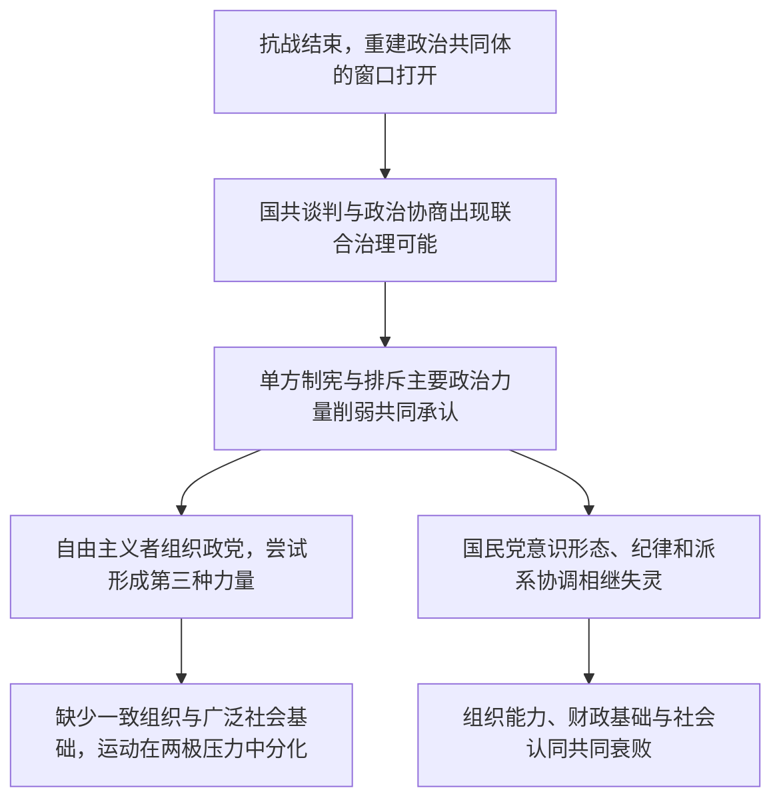

# 战后政治共同体重建—自由主义参与—国民党组织解体

> 一条据许纪霖《中国现代化史》第一卷第二十二章建立的政治史与社会史线索：谈判、公共舆论与政党组织如何尝试重建战后秩序，又为何难以稳定下来？

## 证据节点

| 环节 | 书内 / PDF页码 | 本章材料 |
|---|---|---|
| 战后参与扩展 | pp.508–509 / pp.524–525 | 国共谈判、参政会、报刊与组党活动，显示社会政治参与扩大 |
| 政治共同体重建受挫 | pp.510–511 / pp.526–527 | 国民党单方面召集国民大会，主要政治力量被排除，形式合法性无法重建共同承认 |
| 自由主义第三种力量 | pp.512–518 / pp.528–534 | 民盟等团体试图在国共之外形成政治选择，同时面临组织松散、社会基础有限和两极冲突压力 |
| 国民党组织自我解体 | pp.519–528 / pp.535–544 | 意识形态失效、派系竞争、个人化权力及纪律腐败削弱国民党组织和治理能力 |
| 书后记与鸣谢 | pp.529–531 / PDF pp.545–547 | 编辑说明本书写作时期、面向的读者及研究局限；PDF p.548为空白末页 |

## 论述路径

## 跨学科入口

- **制度史**：国民大会、政治协商会议和联合政府诉求，各自如何代表或排斥政治力量？
- **知识分子与传播史**：报刊、公共论争和党派组织怎样将知识意见转化为政治参与？
- **组织社会学**：松散联盟、革命党和个人化权力在组织凝聚方面有何不同？
- **政治经济学**：财政崩溃、军事消耗和利益集团为何会侵蚀国家组织与社会认同？

## 解释边界

本链概括许纪霖本章的解释，不将国共冲突、自由主义运动失败或国民党衰败归于单一原因。政党档案、报刊资料、军事史和地方史仍待互证。

## 关联档案

- [第二十二章读书卡](../01_单书档案/中国现代化史第一卷第二十二章国民党政权在大陆的衰败.md)
- [战后政治共同体与合法性概念卡](../04_核心概念/战后政治共同体与合法性（许纪霖第二十二章视角）.md)
- [战后国共谈判与政治协商会议事件卡](../03_历史事件/战后国共谈判与政治协商会议（许纪霖第二十二章视角）.md)
- [战后自由主义运动事件卡](../03_历史事件/战后自由主义运动（许纪霖第二十二章视角）.md)
- [第二十一章读书卡](../01_单书档案/中国现代化史第一卷第二十一章文化的价值重建与政治抉择.md)
