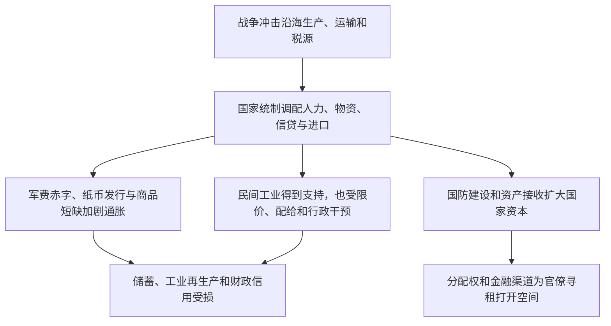

# 战时统制—国家资本—民间工业—财政危机

> 一条据刘方健《中国现代化史》第一卷第二十章建立的经济史线索，并与施正中第十六章对读：战争如何改变国家与市场的关系，短期资源动员又怎样转化为长期财政风险？

## 证据节点

| 环节 | 章节位置 | 本章材料 |
|---|---|---|
| 战争破坏供给与税源 | 第二十章，书内pp.460–462 / PDF pp.476–478 | 沿海工业、交通、贸易和财政基础受冲击，后方经济资源短缺 |
| 统制和民间工业 | 第二十章，书内pp.463–469 / PDF pp.479–485 | 迁厂、采购、信贷和原料调配支持一部分生产，也因限价、配给和行政控制压缩民营空间 |
| 国家资本和官僚寻租 | 第二十章，书内pp.470–476 / PDF pp.486–492 | 国防工业与敌伪资产接收扩大国营部门；贷款、外汇与经营特权也可能被权力关系攫取 |
| 通胀与财政信用崩解 | 第二十章，书内pp.477–483 / PDF pp.493–499 | 战争支出、税源不足、货币发行和物资短缺互相强化，侵蚀储蓄、生产与政府信用 |
| 战前国家经济建设 | 第十六章，书内pp.379–392 / PDF pp.395–408 | 国家资本、银行改组与法币改革曾为内地工业和市场恢复提供条件，也留下集中资源与财政风险 |

## 论述路径

## 跨学科入口

- **经济史**：资源统制对不同行业、地区和企业的效果有何差异？
- **公共财政与货币史**：货币发行、税收、政府债务与物资短缺怎样共同作用？
- **政治经济学**：国家投资何时形成公共能力，何时变为特定利益集团控制的资本？
- **社会史**：价格、薪资、储蓄和供应变化如何重分配战争成本？

## 解释边界

本链整理刘方健本章与施正中第十六章之间的可回查关系，不把战时统制、国家资本和官僚资本视作同义概念。具体数据与个案须回到原始财政、银行和企业档案核对。

## 关联档案

- [第二十章读书卡](../01_单书档案/中国现代化史第一卷第二十章战时统制经济.md)
- [战时经济统制概念卡](../04_核心概念/战时经济统制与资源动员（刘方健第二十章视角）.md)
- [官僚资本概念卡](../04_核心概念/官僚资本（刘方健第二十章视角）.md)
- [战时通货膨胀与财政总危机事件卡](../03_历史事件/战时通货膨胀与财政总危机（刘方健第二十章视角）.md)
- [第十六章读书卡](../01_单书档案/中国现代化史第一卷第十六章南京政府的十年经济.md)
