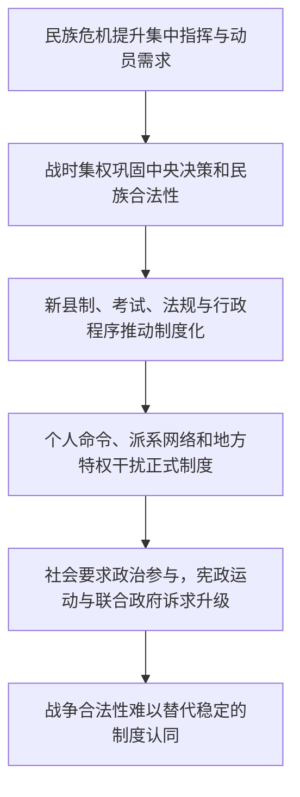

# 战时集权—制度化—民主挑战与合法性危机

> 一条据陈廷湘《中国现代化史》第一卷第十九章建立的来源限定线索：民族危机如何带来集权需求，制度建设为何未能消解社会对政治参与的要求？

## 证据节点

| 环节 | 书内 / PDF页码 | 本章材料 |
|---|---|---|
| 民族危机带来权威认同 | pp.438–442 / pp.454–458 | 抗战使国民党政权获得新的民族动员合法性，并建立国防最高委员会及战时集权结构 |
| 制度化建设 | pp.443–446 / pp.459–462 | 新县制、考试铨叙、法规、权限划分和行政三联制试图提升行政秩序 |
| 个人权力与行政无序 | pp.447–451 / pp.463–467 | 侍从室、个人手令、党政关系和地方特权削弱正式程序与基层实施 |
| 民主挑战升级 | pp.452–459 / pp.468–475 | 宪政运动、民主党派和联合政府诉求挑战一党集权，反映战时合法性的时限和社会参与问题 |

## 论述路径

## 跨学科入口

- **政治制度史**：紧急状态中权力集中与制度约束之间如何变化？
- **行政社会学**：正式机关、私人网络、党组织和地方精英如何共同影响命令执行？
- **社会运动史**：何时有限协商足以维持合作，何时会转向要求重组政权？
- **民族主义研究**：抗战动员的合法性如何在战事变化中延续或衰退？

## 解释边界

本链仅整理陈廷湘一章内部的关系，不据此判断战时集中权力在所有国家或场景中必然成功或失败。合法性、行政能力、军事动员和民主参与须分别考察。

## 相关档案

- [第十五章读书卡](../01_单书档案/中国现代化史第一卷第十五章国民政府权威的建立与困境.md)
- [第十八章读书卡](../01_单书档案/中国现代化史第一卷第十八章主体文化与文化主体的颠覆.md)
- [第十九章读书卡](../01_单书档案/中国现代化史第一卷第十九章国民政府的战时集权.md)
- [战时集权与政治制度化概念卡](../04_核心概念/战时集权与政治制度化（陈廷湘第十九章视角）.md)
- [抗战时期宪政运动与联合政府诉求事件卡](../03_历史事件/抗战时期宪政运动与联合政府诉求（陈廷湘第十九章视角）.md)
