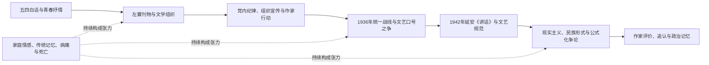

# 文学运动—党派组织—作家主体性—历史记忆

## 核心问题

当现代文学运动和政党组织彼此交叠时，作家如何保持或失去创作判断？文学史又怎样把个人的犹疑、组织冲突和作品差异重新写成革命进程的故事？

本链以夏济安《黑暗的闸门》六篇论文为主要材料。它是知识库的组织方式，不是夏济安逐字提出的一条统一因果理论。

## 一条历史—文学链

箭头表示在本书材料中可追踪的历史关联，不等于单线因果。家庭和私人情感、传统语言、死亡经验并非政治史的旁枝；它们有时支持、有时抵抗、也有时重塑作家对政治任务的理解。

## 书内节点

| 节点 | 具体问题 | 书中位置 |
|---|---|---|
| 青年抒情与革命进入 | 个体情感如何被重新解释为阶级意识、组织责任和行动 | 第一、二、五篇，PDF pp.28–125、188–258 |
| 文学组织与党务结构 | 左联的文化领导、党内实际组织权与公开声望如何分离 | 第三篇，PDF pp.126–170 |
| 文学形式与传统记忆 | 鲁迅反传统的公共语言如何与经典形式、鬼魅经验和内在阴影共存 | 第四篇，PDF pp.171–187 |
| 统一战线与文学口号 | “国防文学”和“民族革命战争的大众文学”如何代表不同组织策略与创作边界 | 第三篇，PDF pp.144–170 |
| 延安制度与创作规范 | “为工农兵服务”、现实主义、民族形式及思想改造怎样影响写作 | 第六篇，PDF pp.259–287 |
| 纪念与历史叙述 | “烈士”、作家和党内异议者如何被后来的党史及文学史重新定位 | 第五、六篇，PDF pp.188–258、259–287 |

## 跨学科读法

- **政治史与组织社会学：**文学组织既是作品传播网络，也是纪律、任命、结盟和排斥发生的场域。不能仅从公开宣言推断实际权力分布。
- **媒介史：**党报、左翼期刊、小说、公开信和回忆录共同构成论争现场；同一事件经不同媒介记录后，会出现不同人数、角色与因果叙述。
- **文学与美学：**政治主题不能替代形式判断。夏济安反复比较口号化写作、现实主义细节、抒情诗与讽刺散文的不同作用；他的审美评价本身也有时代立场。
- **主体与情感史：**家庭、恋爱、乡愁、疾病和死亡使“革命者”不再是无差别的身份；但夏济安有时通过心理推断补足史料空缺，需与可查的书信、日记和作品区分。
- **记忆研究：**烈士纪念和政治追认既保存牺牲，也可能压低人物内部的分歧。1931年龙华事件的数字、会议性质和告密过程在本书所引材料中并不一致。

## 两组跨书互读

1. **与林毓生《中国意识的危机》互读：**两书都拒绝把鲁迅压缩成单一姿态。林毓生讨论公开反传统立场与隐示伦理承诺，夏济安讨论文学艺术中的传统幽灵、创作形式与政治组织压力。焦点分别是思想文化模式与文学—组织史，不应把两个概念合并。见[显示与隐示意识](../04_核心概念/显示与隐示意识_鲁迅念旧.md)；该书前言p.15仍缺损，比较不依赖此页。
2. **与德勒兹《普鲁斯特与符号》互读：**两书都重视风格如何使不同经验进入作品，但德勒兹从符号与作品机器讨论形式生产；夏济安主要研究作品如何处于革命组织和政治命令之中。此为分析尺度的比较，不表示两位作者直接对话。

## 阅读边界

夏济安的观点写于1968年，兼具文学批评与当时的冷战政治视野。他引用的共产党党史、当事人回忆和国外研究，不能未经来源核验便合并为确定事实。特别是人数、党籍、会议身份、告密与党内责任，应保留异说，待档案材料补足。

## 关联档案

- [《黑暗的闸门》整本阅读档案](../01_单书档案/黑暗的闸门_夏济安_1968_整本阅读档案.md)
- [《黑暗的闸门》阅读进度](../00_项目管理/黑暗的闸门阅读进度.md)
- [1931年龙华处决案与左联五烈士](../03_历史事件/1931年龙华处决案与左联五烈士.md)
- [知识库总控目录](../00_项目管理/知识库总控.md)
