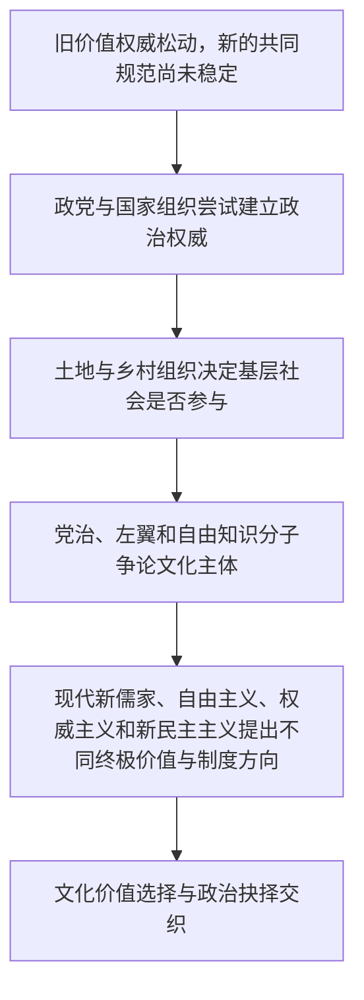

# 权威崩解—终极关怀—价值重建与政治抉择

> 一条据《中国现代化史》第一卷第十三、十五、十七、十八、二十一章逐步累积的同卷阅读线索：价值危机如何转化为政治路线之争，政治组织又如何寻求社会基础与文化认同？

## 证据节点

| 环节 | 章节位置 | 主要问题与材料 |
|---|---|---|
| 五四后的价值重建议题 | 第十三章，书内pp.304–328 / PDF pp.320–344 | 科学、文化认同、社会改造和新价值来源成为公开争论的问题 |
| 党治权威与制度限度 | 第十五章，书内pp.351–372 / PDF pp.367–388 | 国民党以党治、三民主义和组织动员建设国家，但权威与社会认同之间存在张力 |
| 土地、乡村与群众主体 | 第十七章，书内pp.393–414 / PDF pp.409–430 | 土地关系和基层组织影响农民是否成为政治行动主体；目录与章节标题页有一页差异 |
| 文化主体之争 | 第十八章，书内pp.415–437 / PDF pp.431–453 | 党治文化、左翼群众文化和自由知识分子试图确定文化的创造者与价值标准 |
| 四条价值路线及其抉择 | 第二十一章，书内pp.484–507 / PDF pp.500–523 | 新儒家、自由主义、权威主义和新民主主义文化争夺价值依据、政治制度与社会认同 |

## 论述路径

## 跨学科入口

- **哲学**：终极关怀是否必须来自传统形而上学？现代社会如何建立共享价值而不压制思想差异？
- **政治学**：国家组织和政党权威靠什么获得承认？社会动员、制度参与和意识形态如何互相支撑？
- **社会史**：知识分子、农民、工人和中产阶级在不同政治文化中的位置如何变化？
- **文化与艺术研究**：谁被视为文化生产者，作品面向何种公众，政治动员如何改变文化表达？具体作品仍待专题材料核查。

## 解释边界

本链跨越不同作者和不同章节，仅用于建立可回查的阅读路径。各章的“价值权威”“政治合法性”“文化主体”等概念并非同义词；箭头表示可互相追问的历史关系，不意味着价值变化必然导致某一政治结果。

## 关联档案

- [第十三章读书卡](../01_单书档案/中国现代化史第一卷第十三章五四后的社会文化思潮.md)
- [第十五章读书卡](../01_单书档案/中国现代化史第一卷第十五章国民政府权威的建立与困境.md)
- [第十七章读书卡](../01_单书档案/中国现代化史第一卷第十七章现代化变迁中的土地改革.md)
- [第十八章读书卡](../01_单书档案/中国现代化史第一卷第十八章主体文化与文化主体的颠覆.md)
- [第二十一章读书卡](../01_单书档案/中国现代化史第一卷第二十一章文化的价值重建与政治抉择.md)
- [终极关怀与价值重建概念卡](../04_核心概念/终极关怀与价值重建（高瑞泉第二十一章视角）.md)
