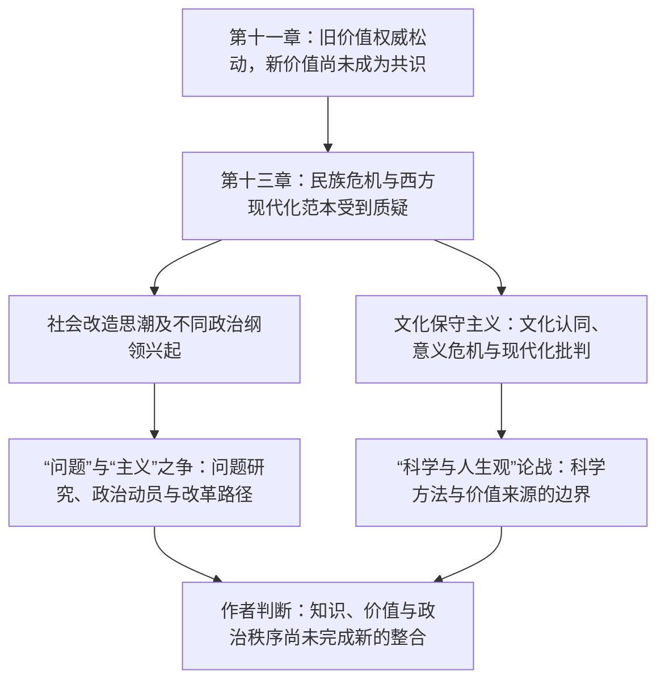

# 民初价值重建—“五四”后社会改造—文化论争

> 一条以《中国现代化史》第一卷第十一、十三章为据的思想史阅读线索。它呈现作者如何把政治秩序变化、知识群体、社会改造思潮和价值论争放在同一历史背景中，不代表所有参与者共享同一目标。

## 证据节点

| 环节 | 章节位置 | 本章呈现的材料 |
|---|---|---|
| 旧价值权威松动 | 第十一章，书内pp.254–279 / PDF pp.270–295 | 辛亥后旧制度的价值支撑减弱，新规范尚未成为广泛共识；《新青年》同人展开价值重估 |
| 社会改造议题突出 | 第十三章，书内pp.304–308 / PDF pp.320–324 | 巴黎和会后的民族主义、现代化范本危机，刊物与知识社团增多，俄罗斯思潮及多种乌托邦方案进入讨论 |
| 问题研究与政治纲领的分歧 | 第十三章，书内pp.309–312 / PDF pp.325–328 | 胡适与李大钊围绕具体问题、主义、社会动员和改革路径展开论争 |
| 文化认同与意义危机 | 第十三章，书内pp.313–320 / PDF pp.329–336 | 杜亚泉、梁启超、《学衡》派和梁漱溟等回应西化与传统价值问题 |
| 科学方法与人生价值 | 第十三章，书内pp.321–328 / PDF pp.337–344 | 张君劢、丁文江、梁启超及其他论者争辩科学知识与人生价值的范围；作者认为价值整合仍未完成 |

## 论述路径

从第十一章到第十三章的连接是同卷互读：第十一章讨论价值权威空缺，第十三章把视野扩展到社会改造、文化保守和科学／人生价值论争。第十三章内部的思潮分类与论争解释据作者原文整理；图中箭头不意味着某一论争单独导致某种政党、革命或制度结果。

## 跨学科入口

- **思想史与政治史**：观念如何转成政治纲领？不同路线的组织和社会基础是否相同？
- **媒介与知识社会史**：报刊、大学、学生社团如何塑造公共讨论？
- **哲学与科学史**：科学解释、人生价值和终极关怀之间怎样区分？
- **比较文化研究**：中西文化比较何时是在描述差异，何时转为价值等级判断？
- **研究限制**：本链只依据高力克两章，人物原著、期刊档案和后续政治过程尚待互证；未推定与现代艺术实践存在直接因果。

## 关联档案

- [第十一章读书卡](../01_单书档案/中国现代化史第一卷第十一章文化变迁与价值重建运动.md)
- [第十三章读书卡](../01_单书档案/中国现代化史第一卷第十三章五四后的社会文化思潮.md)
- [“问题”与“主义”之争事件卡](../03_历史事件/五四后“问题”与“主义”之争（本书第十三章视角）.md)
- [科学与人生观论战事件卡](../03_历史事件/科学与人生观论战（本书第十三章视角）.md)
- [文化保守主义概念卡](../04_核心概念/文化保守主义（高力克第十三章视角）.md)
