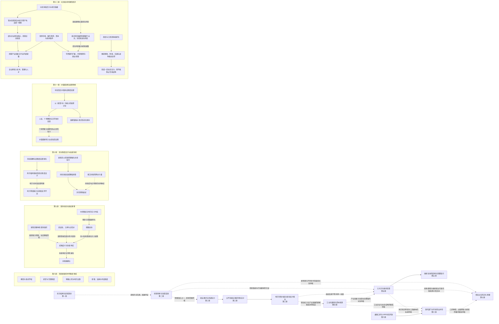

# 清末政治危机—地方势力增长—国家权力重组

> 一条以《中国现代化史》第一卷前七章为据的卷内阅读线索；目前是待互证的组织框架。

## 证据节点

| 环节 | 章节位置 | 目前读到的材料 |
|---|---|---|
| 经济与社会底层 | 第一章，书内pp.027–042 / PDF pp.043–058 | 农业结构、工商业与区域市场、人口土地关系和世界贸易；历史统计仍待核脚注 |
| 思想与改革语言 | 第二章，书内pp.043–062 / PDF pp.059–078 | 明清士风、经世致用、西学输入、“尚富强”与“中体西用”的价值张力 |
| 传统政治秩序与外部压力 | 第三章，书内pp.063–075 / PDF pp.079–091 | 作者关于伦理化统治、主权与法律冲击的解释 |
| 叛乱与地方军事力量 | 第三章，书内pp.076–089 / PDF pp.092–105 | 太平天国作为王权危机；随后讨论地方军队、督抚权限和中央—地方关系变化 |
| 工业起步与资本形式 | 第四章，书内pp.090–108 / PDF pp.106–124 | 外资、公营与私营路径并存；地区和行业差异明显，统计待核脚注 |
| 士大夫与维新变革 | 第五章，书内pp.109–135 / PDF pp.125–151 | 知识群体、不同改革模式、地方社会氛围及戊戌变革的双重取向 |
| 通商口岸与二元经济 | 第六章，书内pp.136–159 / PDF pp.152–175 | 新型工商群体、口岸中心、1895年后的开放及现代部门与传统农业并存 |
| 经典重释与文化思潮 | 第七章，书内pp.160–183 / PDF pp.176–199 | 旧传统与新思潮、古经重释、佛教入世和西学传播 |
| 制度改革与政治参与 | 第八章，书内pp.184–211 / PDF pp.200–227 | 新学与废科举、新军、预备立宪、修律及法院制度 |
| 革命组织与政权更替 | 第九章，书内pp.212–233 / PDF pp.228–249 | 新知识群体、咨议局、中央地方冲突、保路运动、武昌起义及共和建立 |
| 民初权力与权威危机 | 第十章，书内pp.234–253 / PDF pp.250–269 | 南京临时政府制度设计、地方渗透与财政、袁世凯集权及洪宪帝制失败 |
| 价值秩序松动与文化重建 | 第十一章，书内pp.254–279 / PDF pp.270–295 | 民初价值权威空缺、《新青年》启蒙、人性批判、白话文和社会改造 |
| 北洋时期国家经济控制衰退与工商组织成长 | 第十二章，书内pp.280–303 / PDF pp.296–319 | 官办企业与银行转向商办、产业和金融发展、企业经营环境、商会的社会影响及其限度 |
| “五四”后社会改造与文化价值论争 | 第十三章，书内pp.304–328 / PDF pp.320–344 | 西方现代化范本危机、问题与主义之争、文化保守主义、科学与人生观论战 |

## 暂定关系图

第三章中“叛乱应对—地方势力增长”的联系是作者在本章内提出的；第四章讨论多种工业化路径；第五章分析知识群体与维新改革；第六章考察口岸和二元经济格局；第七章追踪文化思潮与经典解释；第八章并列呈现教育、军事、立宪和法律改革；第九章按作者叙述呈现革命组织、地方财政和权力冲突、保路运动到武昌起义及共和建立。第八章子图作制度分类；第九章实线整理本章事件序列，虚线标出组织联系有限、社会基础不足等作者的保留判断。两章均不据此证明跨领域的单一、充分因果。

第十章进一步区分实际权力与权威基础，记录南京临时政府的制度设计及袁世凯集权、帝制复辟的作者解释；新增子图按单章论述组织，权力控制不等同于社会承认。

第十一章讨论旧价值秩序失去政治支撑后，新价值体系尚未形成广泛共识的状态，并呈现启蒙、个人解放与社会改造之间的张力；新增子图概括作者的章节路径，不表示它是普遍且线性的历史规律。

第十二章把政治权力的分散带入经济组织层面：作者以中央财政与控制能力衰退解释一部分官办企业、银行转向商营，同时考察产业扩张、银行经营转向、企业家调整和商会政治表达。图中“外部环境—产业／金融”概括作者并列讨论的条件，不表示单因决定；商会的影响也只限于施压和协商，不能等同于阻止战争或建立自治政府。与第十章的联系是同卷对读线索，仍需地方档案和企业资料检验具体因果。

第十三章将“五四”后的社会改造、文化保守主义和科学／人生价值论争并置于民族主义与现代化范式危机的背景中。它与第十一章的价值重建主题构成同卷互读；具体论争及作者的论证路径另见[价值重建—社会改造—文化论争知识链](民初价值重建—五四后社会改造—文化论争.md)。此处只把它作为理解现代化思想选择的节点，不把思想论争直接等同于政权更替的充分原因。

## 研究问题

1. 第一章所述的市场、人口和地方资源条件，是否具体支持了第三章的叛乱动员或地方筹饷？需要哪些地区材料？
2. 第二章的新思想与改革话语进入了哪些官僚、士人、军人或地方组织？其实际影响如何区分？
3. 太平天国的军事压力与清廷地方军队的发展，是短期应急、长期制度转型，还是不同地区各异？
4. 第五章所列三种政治变革模式分别怎样回应王权、儒学传统与地方社会？
5. 教育、报刊、地方商业与士大夫网络是否构成工业投资和政治改革之间的社会中介？需要哪些独立材料？
6. 通商口岸集中的资本、交通与教育资源，如何改变周边农业和内地市场？二元格局中的部门联系有多强？
7. 经典重释、佛教入世与西学译介分别经由哪些知识网络传播？它们与教育、印刷及后来的艺术文化机构有何可证关系？
8. 新式教育、军队和法律职业如何改变知识群体与国家组织？需要何种地方实施资料？
9. 预备立宪的文本承诺、咨议机构的实际权限和请愿运动之间有何差异？
10. 修律中的法律译介和法典编纂如何进入法院及具体审判实践？
11. 革命组织、会党、新军和咨议局的成员结构与动员能力，在各省如何不同？
12. 四川铁路投资、租股、税赋和保路行动之间的关系，怎样用地方档案互证？
13. 推翻清朝与建立稳定的民主制度为何不是同一件事？民国初年的制度运行材料如何检验本章判断？
14. “权力危机”与“权威危机”在本章中分别指什么？它们如何作用于南京临时政府与袁世凯政权？
15. 袁世凯的中央集权何以能够增强实际控制，却未能建立稳固的权威基础？需要哪些政令、议会和地方材料互证？
16. 《新青年》同人如何协调个人解放与国家富强之间的张力？书中哪些分歧被作者突出？
17. 白话文推广改变了哪些知识传播条件，又为何没有消除知识者语言与大众语言之间的距离？

**证据状态**：同一卷内前十三章的顺序性对读；第三章、第五至第十三章内部的论述路径有原文支持；政治权力变化与产业发展的具体跨章因果、地方网络与工商组织的互构、社会改造思潮与其后政权变化的关系仍待核；未建立机器可读关系。

**关联档案**：[第一卷目录地图](../01_单书档案/中国现代化史第一卷目录地图.md)、[第二章读书卡](../01_单书档案/中国现代化史第一卷第二章新思潮的萌动.md)、[第三章读书卡](../01_单书档案/中国现代化史第一卷第三章危机中的政治嬗变.md)、[第四章读书卡](../01_单书档案/中国现代化史第一卷第四章中国工业化的发轫.md)、[第五章读书卡](../01_单书档案/中国现代化史第一卷第五章士大夫的流产变革.md)、[第六章读书卡](../01_单书档案/中国现代化史第一卷第六章社会经济结构的二元化.md)、[第七章读书卡](../01_单书档案/中国现代化史第一卷第七章世纪转折点上的文化思潮.md)、[第八章读书卡](../01_单书档案/中国现代化史第一卷第八章清末新政从传统向近代的过渡.md)、[第九章读书卡](../01_单书档案/中国现代化史第一卷第九章新政的替代物革命.md)、[第十章读书卡](../01_单书档案/中国现代化史第一卷第十章从民主政治到权威政治.md)、[第十一章读书卡](../01_单书档案/中国现代化史第一卷第十一章文化变迁与价值重建运动.md)、[第十二章读书卡](../01_单书档案/中国现代化史第一卷第十二章北洋政府时期的经济.md)、[价值重建概念卡](../04_核心概念/民初价值权威空缺与价值重建（高力克本章视角）.md)、[权力／权威危机概念卡](../04_核心概念/权力危机与权威危机（孙立平本章框架）.md)、[洪宪帝制事件卡](../03_历史事件/袁世凯复辟帝制与洪宪政局（本书第十章视角）.md)、[辛亥革命事件卡](../03_历史事件/辛亥革命与保路运动（本书第九章视角）.md)、[清末新政事件卡](../03_历史事件/清末新政与预备立宪（本书第八章视角）.md)、[二元结构概念卡](../04_核心概念/社会经济二元结构（近代中国）.md)、[古经新释概念卡](../04_核心概念/古经新释与近代经学转向.md)、[太平天国运动](../03_历史事件/太平天国运动（本书第三章视角）.md)、[戊戌变法与维新运动](../03_历史事件/戊戌变法与维新运动（杨念群本章视角）.md)、[马关条约与战后开放](../03_历史事件/马关条约与战后开放（本书第六章视角）.md)。
