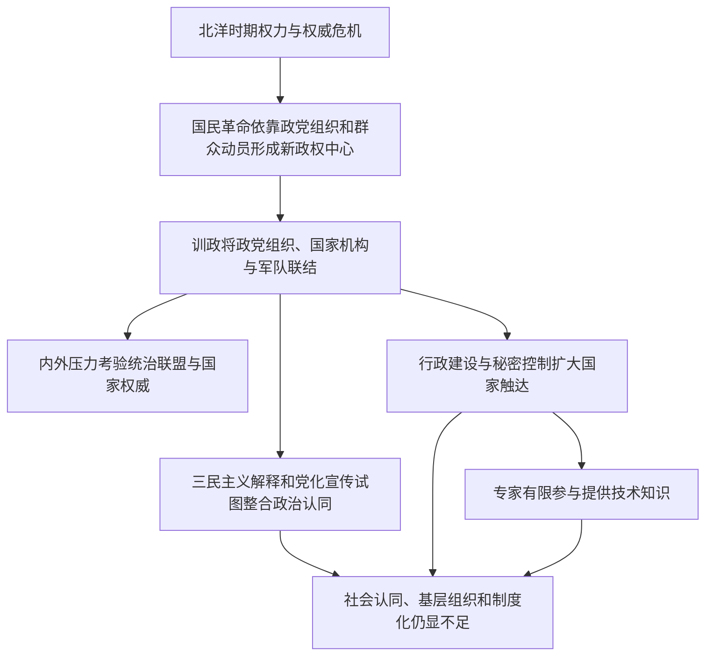

# 革命动员—党治国家—政治权威与社会参与

> 一条据《中国现代化史》第一卷第十四、十五章整理的同卷跨章线索：革命组织赢得政权之后，如何把动员能力转化为持久的国家权威？下列关系分别归于王跃、高华两章，不预设唯一的现代化道路。

## 证据节点

| 环节 | 章节位置 | 本章材料 |
|---|---|---|
| 旧权威危机与革命动员 | 第十四章，书内pp.343–350 / PDF pp.359–366 | 五卅运动、国民会议、国民党改组、工农组织与北伐；作者强调民族权利诉求和直接民权如何扩大政治动员 |
| 党组织进入国家结构 | 第十五章，书内pp.351–356 / PDF pp.367–372 | 训政体制、党统政与党军组织；政党组织被用来协调中央权力、军队和社会动员 |
| 内外挑战考验统治权威 | 第十五章，书内pp.357–360 / PDF pp.373–376 | 中共、地方军事力量与日本构成挑战；“安内攘外”政策与社会抗日要求之间发生冲突 |
| 意识形态与行政控制 | 第十五章，书内pp.361–369 / PDF pp.377–385 | 三民主义政策解释、官僚机构、党务网络和秘密控制组织；集中权力并未自动形成广泛社会认同 |
| 技术参与与政治开放 | 第十五章，书内pp.370–372 / PDF pp.386–388 | 专家参与外交、经济、教育和立法工作，但核心政治结构与决策权保持有限开放 |

## 论述路径

## 跨学科入口

- **政治史与比较政治**：革命党如何转化为执政党？党—政—军整合如何改变权力分配与制度化？
- **社会学**：群众动员、基层组织、秘密控制和社会自治之间如何互动？国家“看见”社会与社会承认国家有何差别？
- **思想史**：民族主义、民权、民生、传统文化与苏俄组织经验如何被重释，何时出现相互矛盾？
- **行政史与经济史**：专业知识何时进入政府？技术官僚参与能否影响资源配置和政治决策？
- **文化与艺术史**：第十五章讨论党化教育和出版审查，但没有具体艺术作品或艺术制度案例；与艺术史的直接连接待后续证据支持。

## 解释边界

第十四章与第十五章的作者不同，章节关注点也不同：王跃着重革命动员与权力转移，高华着重党治建制、政权权威及其限制。本链只呈现两章间可回查的议题衔接；箭头不表示每一步都是必然结果，也不取代各章的独立解释。对于国民党统治的实际社会效果、区域差异和其他研究的解释，还需增加原始材料与互证。

## 关联档案

- [第十四章读书卡](../01_单书档案/中国现代化史第一卷第十四章军绅政权和国民革命.md)
- [第十五章读书卡](../01_单书档案/中国现代化史第一卷第十五章国民政府权威的建立与困境.md)
- [军绅政权概念卡](../04_核心概念/军绅政权（王跃本章视角）.md)
- [党治国家概念卡](../04_核心概念/党治国家（高华第十五章视角）.md)
